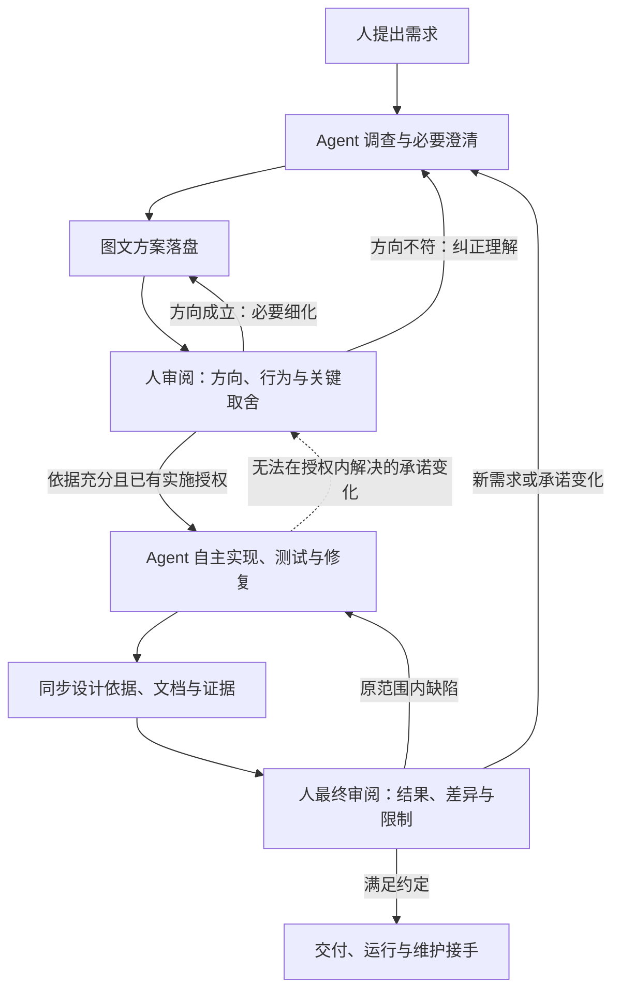

# AI 原生软件工程方法：完整规则

设计稿 v0.8 · 修订于 2026-09-24 · 当前依据：[v0.8 评审](review-v0.8-by-claude.md)。本轮只补充状态与呈现规则，保留版本号，修订以 Git 提交区分。

本次范围为方法设计：**实现进度：设计稿完成**（工具实现不在本次范围）｜**验证完整性：部分验证**（桌面推演与交叉评审，未试运行）｜**人的接受：待审阅**｜**发布情况：不适用**。

**人提出需求，agent 通过必要对话形成落盘的图文方案；以少量、有实质进展的审阅建立共同理解，再自主实现、测试并维护文档，最后由人审阅实际结果。工程知识随交付保留，使后续人和 agent 能够接手。**

本页保存当前方法的完整规则。首次阅读从 [项目入口](README.md) 或 [交互图解](overview.html) 开始；需要核对继续条件、证据和维护规则时再查本页。[研究原稿](research/README.md) 已归档；[历史讨论与来源](design-history-v0.5.md) 保留三家资料、skill 对照和设计演进，供追查，不作为并行规范。下文的活动是信息与责任划分，不要求分别生成文件、配置角色或建立审批节点。

## 1. 主流程与职责

人负责意图、价值判断、关键承诺及结果接受。agent 负责调查、提出方案、控制细化深度、工程实现、验证与知识维护。人可以随时纠正或要求展开；agent 不能把自己的推荐、人的沉默或机械连答视为整体接受。

一次委托可以只交付方案，也可以交付软件。较大目标分成可验收增量：每个增量产生有用行为，或解决决定性的未知。后续增量复用既有意图、设计和授权，不重新访谈；多个增量共同遵守系统边界、公共契约和集成要求。

新建系统先形成整体图。已有系统的小改动可用现有整体图加局部差异说明；已有审阅依据和授权足够时，不增加重复确认。并行工作共享有效决定，组合后验证；并行数量不能超过集成与审阅能力。

## 2. 每项活动如何开始、怎样继续

| 活动与触发 | 最少依据 | 本次形成或更新什么 | 足以继续的条件；何时返回人 |
| --- | --- | --- | --- |
| 形成首版方案：收到新需求或方向变化 | 已有需求、相关系统事实、已知限制 | 目标与非目标、整体图、代表场景、关键未知 | 已能让人比较实际结果；只有影响方向且无法调查得到的内容才提问 |
| 审阅与细化：方案已落盘，或反馈要求修订 | 当前图文、反馈及上一轮有效决定 | 纠正后的方案、变化理由、必要细节、下一步建议 | 达到第 3 节的实现条件即收敛；方向冲突先纠正，不继续展开下层 |
| 实现与验证：依据充分且授权明确 | 当前有效设计、验收办法、环境与关键约束 | 代码、检查结果、实现中形成的设计依据 | 原范围问题自行修复；证据与知识满足后提交最终审阅；承诺越界按第 4 节处理 |
| 最终审阅：实现与必需验证满足 | 实际交付版本、方案差异、证据、限制 | 人的反馈、接受范围和剩余事项 | 满足约定后交付；缺陷修复，新需求重新定界。分别表达实现进度、验证完整性、人的接受及发布状态，见第 5 节 |
| 维护与接手：新任务、中断恢复或运行反馈 | 当前入口、实际版本、受影响约束、检查点 | 影响判断、变更及更新后的知识与证据 | 能定位依据并验证判断后继续；重大未知先取证，无法解决且影响承诺时再询问 |

审阅是对具体范围作出判断。认可整体方向，不等于接受尚未展开的细节；接受细节，也不自动授予发布或不可逆操作权限。已有明确授权持续有效，无需为了表格中的每个活动重新获得许可。

## 3. 让图文审阅有价值，并及时结束细化

每轮先回答一个问题：**这次需要人理解或判断什么，判断会改变哪项工程动作？** 首轮看目标、边界和主行为；后续优先展示差异，再链接最新全貌。图与解释相邻，只呈现支持本轮判断的结构、流程、状态或原型。

审阅产物包含当前方案、实质变化、关键取舍与未知，以及 agent 对下一步的建议。事实由 agent 调查；可逆且低影响的局部选择由 agent 决定。人的偏好或业务判断尽量通过具体场景和有实质差异的方案表达，不变成全量问卷。

首版及后续审阅中，agent 显式列出**本轮确实需要人决定但尚无依据的事项**，说明影响、阻塞范围和建议；已明确的要求与授权直接引用，不重复提问。根据真实反馈记录接受、纠正或暂不决定及对应范围，允许一次整体反馈覆盖多个事项，不要求逐项点击。暂不决定只阻塞依赖该决定的承诺性动作，授权内的调查、实验和不相关实现仍可进行。

进入实现时引用具体方案版本、相关反馈与授权，并标明剩余未知如何处理。这使“有何依据继续”可审查，但不声称记录接受就能证明人的理解；若反馈只涉及局部推荐，不能扩大为接受整体方案。

笼统反馈按当时明确展示的审阅范围、所提问题和已有授权解释。例如“方向可以，你做吧”支持已展示方向内的实施，不自动解决仍被标为待决定的业务冲突，也不覆盖未展示的高影响取舍。已明确呈现关键后果且用户整体授权覆盖的事项，无需再逐项批准。agent 在继续工作的摘要及当前审阅入口的显著位置说明采用的范围，并在下一次审阅时保留；若歧义会改变关键承诺，只澄清该项并暂缓相关动作，摘要本身不能创造授权。

**迭代**修正理解或方案；**细化**在方向成立后展开必要内容。二者都以更新有效文档为主，不按讨论轮数复制文件。

| 当前情况 | agent 采取的动作 |
| --- | --- |
| 目标、范围或代表行为存在分歧 | 用场景与整体图纠正理解，暂缓依赖该分歧的细化 |
| 下一个决定会影响公共契约、关键质量或难逆转的结构 | 展开相关部分，比较取舍与验证办法；不顺带展开所有模块 |
| 不确定性可以通过测量、原型或技术实验消除 | 先在授权内取证，再把结论及局限带回方案 |
| 剩余选择局部、可逆且不改变已接受承诺 | 移入实现，保存值得维护者知道的理由 |
| 连续讨论没有改变判断，或只是逐项接受推荐 | 停止追加同类问题，改用具体结果或对比展示；已有充分依据时建议实现 |

进入实现时，当前增量具备以下条件：

- 目标、范围、主要行为与重要限制有共同依据，必要审阅反馈已处理；
- 主要职责与交互足以安排工作，关键约束和难逆转选择已有依据；
- 关键行为和质量要求有判定办法，所需环境与尚缺证据已识别；
- 剩余未知已分为实现中解决、实验后决定或阻塞相关工作，没有隐藏的高影响假设；
- 实施范围与权限清楚，必要工程上下文可获取。

轮数由 agent 根据上述条件决定，不设统一次数，也不以“所有问题都回答了”为终点。每追加一轮说明它将消除什么不确定性；反复无进展时缩小增量或改变取证方式。人的理解不能由勾选或复述考试证明，应从真实反馈、场景判断和后续返工观察，不把沉默视为理解。

## 4. 实现中发现新事实怎么办

文档给出有效意图与设计依据，代码和运行反映实际行为；两者冲突时先取证，不能自动以任一方覆盖另一方。

| 发现或变化 | 处理与人的参与 |
| --- | --- |
| 局部算法、数据结构或文件组织改变，承诺保持 | agent 自主选择、验证并更新必要说明，最终审阅展示重要差异 |
| 新证据推翻暂定技术假设，替代方案仍在授权内 | 更新假设、影响范围和验证计划；完成必要实验后继续 |
| 已接受的行为、公共边界或质量承诺无法保持 | 提供事实、影响、可选方案与推荐；等待必要决定，其他不受影响的授权工作继续 |
| 测试失败或判据疑似错误 | 区分实现问题、环境问题和判据问题；依据原始要求查证，不能为通过而降低标准 |
| 必需环境不可用、预算耗尽或重复失败无新证据 | 保存实际状态和缺口；可继续的工作继续，其余明确受阻，不宣称完整完成 |

人的离线时间不导致全部工作停止。确实需要决定时，集中呈现问题、影响、证据和建议，不逐命令打断。授权涉及的外部操作范围与恢复能力另行明确；不得借助子 agent 或工具扩大权限。

## 5. V 模型、证据与交付判断

采用 V 模型的分层对应和早期验证规划，在每个增量中应用；不把全项目设计完成作为开始编码的条件。这是本方法的增量适配，传统定义及出处保留在历史材料第四部分。

确定重要行为时同时提出可观察结果与判定办法，细节随设计展开。需求、设计与测试判据本身也需检查：测试答案不能只从生成的实现反推。验证检查是否满足要求；确认检查结果是否解决实际问题，原型和最终审阅都可提供后一类依据。

**每份证据必须能回答：验证了哪项主张，针对哪个实际产物与环境，如何获得结果，覆盖什么、遗漏什么。** 分支名或“测试通过”的摘要不能单独代表被测版本；未提交修改、依赖、配置与环境只要影响结果，就属于需识别的被测状态。具体绑定技术留到实现设计。

代码、要求、依赖或环境变化后，先判断哪些主张受影响，再更新相关证据；无影响且仍适用的证据可以复用。跨模块变更检查组合行为，不能以各模块测试通过替代集成。重要或难以判断的变更增加独立取证或复核；多个 agent 同意不构成正确性证明。

最终审阅只需先看结果或演示、相对方案的变化及原因、实际证据、剩余限制和维护入口。未满足的必需验证不能由漂亮演示替代；人接受风险或修改要求时，记录接受的具体范围。

交付状态分开表达：**实现进度**（未完成／完成）、**验证完整性**（未取得／部分验证／已满足）、**人的接受**（待审阅／需修订／已接受）、**发布情况**（未发布／已发布／不适用）。这些维度不能互相代替，也不是一条只进不退的审批链；新变更可能使原有验证或接受范围需要重新判断。提前征求意见可以发生在证据不齐时，但要标为阶段反馈，不能伪装成满足条件的最终交付。

交付候选满足以下统一条件：意图与授权可追溯；约定行为和质量有适用证据，失败未靠降低标准掩盖；图文与实际版本一致，并从一个入口支持理解与接手；重要设计知识、限制及恢复方式可找到；实现、验证、审阅与发布状态如实表达。

提交候选前，agent 对照上述条件链接具体依据并列出缺口，不新增另一份标准或人工批准步骤。过程评估另查是否反复要求无价值确认或越权推进，不能仅凭勾选宣告通过。最终接受由人作出；待审阅如实标注。发布、迁移、回退和停止支持按系统性质与已有授权处理，交付不自动等于发布。运行中的新事实进入后续维护和需求判断。

## 6. 文档与工程知识如何长期有效

每轮正式图文审阅前落盘，实现中随重要发现更新，交付时与实际版本对齐。每项工作在自己的文档中有一个**工作项入口**：先放粗略整体图，再给出当前范围和状态、相关模块、证据及维护线索，下表四类信息都从这里找到。它只指向本方法的规则，不复制规则；**方法入口**（[项目入口](README.md) 或 [交互图解](overview.html)）说明方法怎样工作，不能代替工作项入口。图保留可编辑来源与必要展示资源。当前文档维护有效结论，历史保存演进；不让多个“最终版”竞争。

信息按用途区分，通常可放在现有文档中：

| 信息 | 保留什么 | 更新与失效依据 |
| --- | --- | --- |
| 意图与已接受承诺 | 目标、范围、行为、限制、谁接受了什么 | 有效反馈或授权变更；agent 不能自行伪造接受 |
| 工程知识 | 结论、理由与代价、适用对象、依据、成立条件、重评触发 | 相关设计、依赖、环境或事实发生变化 |
| 验证证据 | 主张、被测状态、方法、结果、覆盖与缺口 | 第 5 节的影响分析 |
| 任务检查点 | 当前实际版本、已完成与未完成工作、恢复线索 | 工作推进或恢复核查；结束后归档临时状态 |

保存知识的门槛是：省略后容易改错，或需付出明显代价才能重新发现。包括关键不变量、假设、重要反例与未采用方案；不保留全部推理、命令或代码的文字复述。能执行的约束尽量进入类型、契约、测试和检查，说明保留原因与前提，二者互相关联。产品语义等无法自动检查的知识仍然有价值。

知识的生命周期明确为：缺乏足够依据时为**暂定**；依据与适用范围明确后为**有效**；前提受影响或出现反证时转为**待复核**；重新取证后恢复有效、修订，或被新结论**替代**。旧结论保留历史原因，当前入口指向有效结论和必要未知。有效不等于经过人工批准：事实验证、授权内决定与人的承诺分别标明来源。

以下三个判断分别维护，不能合并成一个“有效”标记：

| 判断 | 依据与变化 |
| --- | --- |
| 要求或决定是否仍适用 | 来自有效意图、授权决定及适用条件，可以先于代码成立；变化时重新判断承诺 |
| 当前实现是否符合 | 对照要求和实际行为判断为满足、不满足或尚未证实，不能由“已接受设计”推出 |
| 验证结果是否仍适用 | 依据实际被测状态、判据、环境及变化影响判断；失效意味着需要补证，不自动证明实现错误 |

例如“数据不得离开本机”可以已经接受，但实现尚未验证；修改网络依赖后，旧证据可能需复核，要求本身仍然成立。验证方法的位置与一次验证的实际结果也分别保留，测试文件存在不代表运行通过。

发现前提变化的执行 agent 负责标记待复核、关联受影响工作并指定当前工作责任者接续；交接时移交未决项。**再次依赖该结论作出承诺性修改或宣告相关交付满足之前**完成复核，或明确限制相关工作。暂不影响当前范围的条目记录重新触发条件；涉及外部期限时记录具体期限。不用统一天数制造例行审批，也不能把待复核当作无限期有效。

当前执行 agent 在修改前的影响分析和交付核对中，负责识别本次依赖的结论及其复核状态；关联不全时沿接口、调用和相关测试调查，不将检索未命中视为没有约束。实现层需支持这种发现和提醒，但自动分析的覆盖范围仍需说明，不能承诺发现所有隐式依赖。

关联以维护者能定位的需求、模块、接口、代码或测试对象为准，同时交代适用版本与范围；重命名或范围变化时检查关联。具体标识与文件格式留到实现。链接完好只能证明可导航，不能证明内容真实；文档和代码有冲突时必须分析。

接手时从当前入口定位范围，核对实际状态，按影响读取相关理由、约束与证据，再提出并验证修改判断，完成后更新同一组资产。恢复原任务复用检查点；新维护任务重做必要的影响分析。缺少历史理由时可调查和重新论证，但不能将推断伪造成原作者决定。

## 7. 用场景检查方法是否完整

以下是本轮的桌面推演：说明按方法应如何处理，并暴露失败判据；不是实际开发、测试或接力成功的证明。场景表按独立检验价值维护：重复覆盖且不再检验不同边界的场景合并或删除，同时核对原有失败判据是否仍被覆盖。规则已写进正文不代表场景自动失去回归价值，不因每轮评审机械增加场景。

以“批量导入记录”为连续示例，假定本轮已接受：重复提交不得重复写入，单条无效记录不能掩盖其他记录的导入结果，已报告成功的记录必须持久保存。

| 场景与触发 | 按方法推进的结果 | 方法失效的表现 |
| --- | --- | --- |
| 首版只画文件上传和结果页；人指出需要逐条错误原因 | 修正代表场景，补充结果视图与处理流程，明确部分成功语义；先纠正行为，再决定是否展开结构 | 在错误方向上继续讨论数据库字段 |
| 整体方向接受，agent 想继续询问内部类名和批次大小 | 类名自行选择；批次大小按资源约束测量。只有会改变外部承诺的结果需要返回人 | 为填满设计模板反复要求批准 |
| 人接受页面布局，但尚未决定重复记录如何处理 | 保留布局决定，显式记录重复处理语义及阻塞范围；继续不依赖该决定的授权工作 | 将局部接受视为整体接受，或要求所有细节答完才行动 |
| 实现发现源数据没有稳定标识，原去重假设不成立 | 调查可用身份依据；若无法在既定语义下可靠去重，提出取舍并阻塞相关承诺，其他授权工作继续 | 私自改成“尽量去重”，或因为一个问题停掉全部工作 |
| 本地检查通过，但约定的目标数据规模尚未验证 | 保留已有证据，标注性能主张未证实；取证或提交范围明确的决定 | 用功能测试通过宣布全部验收完成 |
| 去重保证仍适用，但实现所依赖的存储行为改变 | 执行 agent 标记相关知识与证据待复核，在依赖它继续修改或交付前重新取证；保证不自动撤销 | 用旧测试结果继续承诺，或把证据过期等同需求失效 |
| agent 中断后换会话继续 | 核对实际产物、文档和证据状态，再恢复未完成工作；相关代码变化后的旧证据重新评估 | 只读上次“已完成”摘要就跳过检查 |
| 后续 agent 为提速，拟在写入持久化前返回成功 | 发现结果持久性的保证，检查崩溃与重试行为；保留承诺或明确提出变更，更新相关证据 | 只看正常路径测试，破坏异常恢复语义 |
| 最终审阅提出原范围缺陷，同时希望增加导出功能 | 缺陷进入修复回归；导出单独定界，不把新功能追溯成原任务未完成 | 反复重做整个方案，或静默扩展范围 |
| 人隔天回复审阅，但没有提供阅读用时 | agent 记录审阅轮次与反馈到达时间，将主动阅读时间记为未知；汇总时区分等待和实际投入 | 把一天等待算成人的审阅工时，虚报方法成本 |
| 接手遗漏持久性约束，团队拟增加逐函数人工批准 | 先检查约束是否存在、可发现、被读取及执行；若入口缺失则修索引并加入接力回归案例，不扩大审批。已有规则若无助于结果则删减并回放原失败场景 | 不调查原因就新增审批，或把知识缺口一律归咎于 agent |

上述推演确定了必须表达的审阅范围、剩余未知、局部阻塞和证据有效性规则。它尚不能证明真实用户的阅读负担或 agent 接手能力，需后续试运行评估。

## 8. 如何判断方法值得采用

评价同时考虑质量、人的负担与总交付成本。后续试运行选择相近规模、风险与领域熟悉度的任务，比较原方式和本方法；记录模型、工具、环境等差异，避免把工具升级归功于方法。缺乏基线时先建立观察记录，不宣称提升百分比。

| 评价问题 | 比较与观察依据 |
| --- | --- |
| 人是否更容易理解、讨论是否更少流于形式？ | 图文审阅次数、实际阅读与决定时间、每轮解决的问题，以及误解导致的返工；明确区分正常设计探索 |
| 自主执行是否带来整体收益？ | 需求到接受的总周期、人工干预及原因、验证与修复时间、运行成本；文档维护和接力成本也计入 |
| 质量是否保持？ | 关键要求覆盖、集成缺陷、验证逃逸和交付后问题；同类任务使用可比较的质量标准 |
| 知识是否足以支持接手？ | 新会话完成代表性维护任务时，约束定位、影响判断、修改结果和无依据推断 |

执行 agent 在每轮审阅反馈、阻塞或恢复、验证结束及交付时，将可观察事实汇总到现有增量记录，并链接原始依据；交付时由当前工作责任者汇总，流程评估时抽样复核。人的实际阅读与思考时间仅用自愿提供或可靠采集的数据，不能以两条消息之间的间隔冒充；缺失记为未知，估算明确标注。指标记录不另开一轮访谈或要求人填写日志。

接力评估在重要模块或交付节点、知识组织或方法重大变更后按风险抽样，普通小修改不另设接力关卡。选择确实涉及既有约束的维护任务，不只改名字；不给原始聊天，但允许正常使用文档、代码和工具。事先根据有效要求确定行为、约束及验证判据，避免事后按 agent 的答案评分。

接手通过的依据是关键保证保持、受影响行为验证充分、必要知识同步，且未靠原作者补充隐藏背景。发现重大未知并正确调查或请求决定是合理行为；资料缺失导致无法完成应记录为知识覆盖缺口，不能把所有失败归咎于接手者。成本是否可接受与正确性分别评价。

重复返工、接力失败、越权或无效审阅发生后，区分规则缺失、执行偏离、资料缺失、工具限制和判据错误，将有代表性的失败及预期行为加入方法回归案例，关联改动的规则。方法修订时重做相关推演，试运行后再回放实际任务。对不能改善判断、质量或理解的规则合并或删除，并检查删除后原有失败是否重现；不能每次失败只增加文档和审批。

设计阶段的收敛条件是：代表场景都能解释下一步、负责人、更新内容、继续与返回条件，没有互相冲突的规则，也没有为了格式增加人工参与。编写 agent 对照条件提供依据与未决项，评审者检查缺口，用户决定是否接受为当前设计基线；接受后记录对应版本，将人的接受状态改为“已接受”，验证状态仍按证据单独保留。真实效率与质量改善仍待试运行证明，接受方法设计本身不自动授权工具实现或试运行。

## 9. 参考取舍与当前边界

复用优先级（用户于 2026-09-24 明确）：**相同或相近能力优先采用 mattpocock/skills**，按已接受的方法目标做必要适配。Trellis、Spec Kit、OpenSpec、Superpowers 等用于对照和启发，不预设引入任何一套框架。只有现有 Matt 能力缺失或适配后仍不能满足目标时，再考虑外部能力或最小自建；show-me、eli5 也按实际缺口选择。研究覆盖范围不等于采用清单。

本方法综合此前核查的 Anthropic、OpenAI、Google/DORA 资料，保留渐进设计、持久上下文、可验证执行、风险分层、整体交付与评估原则。V 模型提供设计与验证的对应关系；这些来源并未共同提出本文流程，也不能替本文证明有效性。完整出处、日期和证据局限见[历史资料](design-history-v0.5.md)。

[show-me 上游源码](https://github.com/humanlayer/skills/blob/main/plugins/show-me/skills/show-me/SKILL.md) 的最小视图与差异呈现用于帮助理解；本轮未在本地安装它。[grill-with-docs 上游源码](https://github.com/mattpocock/skills/blob/main/skills/engineering/grill-with-docs/SKILL.md) 的必要澄清、术语和决定记录用于形成共同依据。舍弃穷尽式访谈和把所有局部选择交给人的做法。借用机制不意味着绑定、安装或原样执行某个 skill。

本轮已明确工程知识的内容与生命周期、证据的适用关系、各活动的继续条件、接力评估和基线方法。文件 schema、命令、检查器、skill 编排、证据绑定技术、待复核结论的依赖发现与影响分析、指标采集实现留待方法审阅收敛后设计。

本轮评审取舍：补充审阅入口中的范围说明、场景表删减原则和本次设计的四维状态；已有推演与评审计为部分验证，不能替代试运行。未发现需要扩展主流程的新分歧，当前提交为设计定稿候选；评审建议进入实现不构成用户授权。
