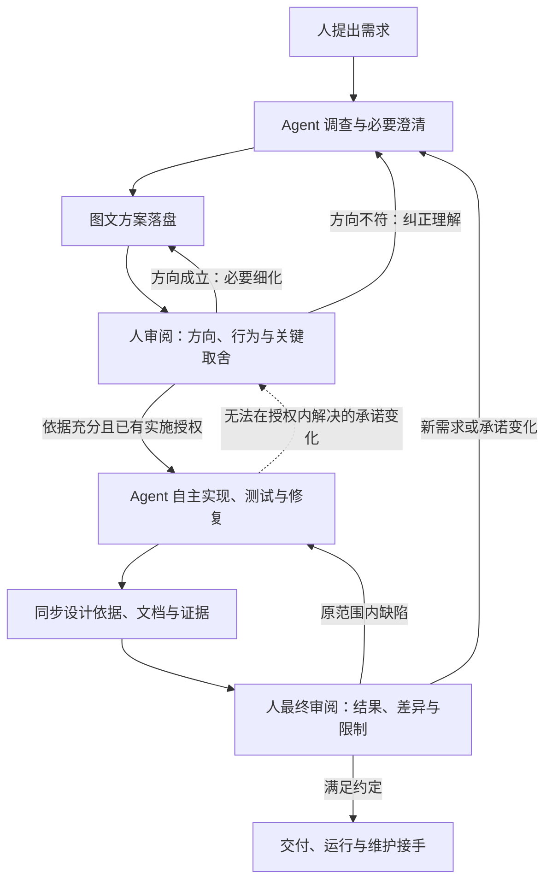

# 和 agent 一起把软件做对

**先看懂它准备做什么，再让它连续完成实现；最后看结果，并留下别人能接手的依据。**

[打开交互图解](overview.html) · [查完整规则](METHOD.md) · [看 skills 借鉴研究](research/mattpocock-skills-assessment-20260924.md)

## 这个流程怎样工作

你主要判断两件事：**方案是不是你想要的，结果是不是做到了。** 中间的局部选择、测试与修复交给 agent。已有的要求和授权继续有效，不必每一步重新批准。

## 用一个例子看懂

你说：“我要导入一批记录，重复上传不能重复写入，出错时要知道哪条失败。”

| 到哪一步 | 你会看到什么 | 这时需要判断什么 |
| --- | --- | --- |
| 先看方案 | 一张“上传 → 检查 → 写入 → 查看结果”的图，加上重复和出错的例子 | 这是不是你想要的使用方式？ |
| 必要时细化 | 展开有争议的部分，例如两条记录怎样算重复 | 这个业务规则是否合适？内部函数名由 agent 自行决定 |
| 连续开发 | agent 实现、测试、修复，并记录新发现 | 只在无法保持已接受承诺时回来讨论；其他授权工作继续 |
| 看交付结果 | 可用结果、与原方案的差异、实际测试结果和未验证项 | 结果是否满足需求，哪些限制仍需处理？ |
| 换人或换 agent | 最新整体图、关键约束及原因、代码与测试入口 | 不找回原聊天，是否也能正确修改？ |

**什么时候结束讨论？** 当再问一轮已经不会改变重要判断，而剩余细节能通过实现或实验解决时，agent 就应建议开工。人仍能要求展开；方向没有讲清时，先纠正，不往下堆细节。

## 文档怎样保持好读

每轮先展示三件事：**整体图、相对上轮的变化、需要你判断的地方**。原理和限制紧挨相关图；实现细节、证据和历史按需查阅。图不能省掉会改变判断的重要例外。

我们自己的文档也采用这个顺序：本页与图解帮助理解，`METHOD.md` 保存完整规则，研究与评审供追查。它们从同一入口找到；修改方法时同步相关说明，不维护相互冲突的“最终版”。

## 现成 skills 怎样帮忙

- **优先复用 mattpocock/skills**：相同或相近能力采用它的实现，并按本方法调整冲突的提问、确认和保存规则。
- **show-me**：用结构图、时序、状态或差异说明“怎样工作、哪里变了”。
- **eli5**：用大图少字解释陌生概念；对工程评审保留真实名词、关键条件与例外。

其他项目先作为参考；只有 mattpocock/skills 缺少所需能力，或适配后仍不能满足目标时，才考虑外部补充或最小自建。show-me、eli5 也按这个原则选择，不因列在这里就要求全部采用。尚未安装、适配或实现工作流；来源与组合限制见[研究说明](research/mattpocock-skills-assessment-20260924.md)。

## 当前进展

方法设计为 **v0.8 定稿候选**，本轮调整阅读方式。已做桌面推演与交叉评审；**尚未通过真实任务证明效果，也尚未进入工作流工具实现**。你的接受状态仍为待审阅。

查阅：[完整规则](METHOD.md) · [最新交叉评审](review-2531f0d-by-claude.md) · [研究资料](research/README.md) · [历史讨论](design-history-v0.5.md)
