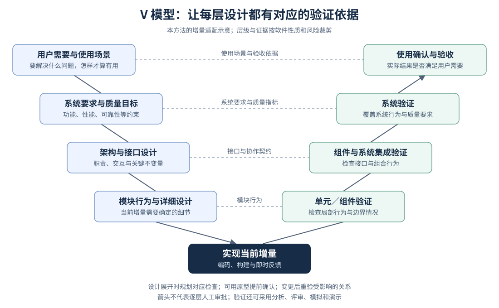

> 历史讨论与研究依据，非当前方法规范。当前设计以 [README](README.md) 为准。以下保留 v0.5 原文，便于查证来源与演进；旧章节中的待办和规则不构成额外要求。

# AI 原生软件工程方法

状态：讨论稿 v0.5，2026-09-21。明确图文审阅、有限细化、自主实现与最终审阅的主流程；保留工程知识与跨 agent 接力要求。规则仍需代表任务验证。

这是一套面向软件工程的通用方法，覆盖从需求发现、系统设计、实现验证到交付、运行和持续演进。设计起点是软件工程需要解决的问题；个人工作习惯、具体项目和工具是后续适配条件。新建系统从领域与边界开始，已有系统先取得当前行为和架构的事实依据。

具体模型、CLI、skills、MCP、CI 或管理平台都是承载方式。本文先定义工程活动如何组织、决定如何形成、结果如何证明，再讨论怎样实现自动化。

方法按职责分层：**工程内核**规定需要维护的对象、关系和质量条件；**AI 执行层**规定 agent 怎样在授权内主动推进、取证、恢复和请求决定。工具负责承载这些规则。这里的通用性指跨项目、技术栈和工具适用；AI 自主执行仍是本方法的核心能力。

本版吸收 Anthropic、OpenAI、Google/DORA 的研究与实践，并将 **V 模型的设计—验证对应关系**放入工程内核：每层设计同时考虑如何证明正确，证据随着增量逐步获得。资料的性质、局限和具体取舍见第八、九部分。

## 方法总览

**人提出需求，agent 经过必要对话形成落盘的图文方案；双方以少量、有实质进展的审阅迭代建立共同理解，达到可实现深度后，agent 自主完成实现、测试与文档同步，最后由人审阅结果。**

agent 根据不确定性、风险和反馈决定是否需要下一轮细化，并说明理由；人可以纠正方向、要求展开或授权进入实现。轮次不固定，默认尽早收敛。人的审阅聚焦目标、行为和关键取舍，实现期间不需要逐步骤值守。工程内核仍以持续演进的系统模型、可验收增量和 V 模型的设计—验证对应关系支撑这个过程。

这里的“系统模型”是对需求、领域概念、关键行为、架构和质量要求的共同理解，可以用少量文字、图、示例和可执行检查表达。它还需要关联重要设计的原因、适用条件与失效条件，使后续维护者能够重建必要理解。它不要求建立完整形式化模型或生成全部代码。

- 人提供或确认结果、范围、不可接受的后果和授权；agent 提出可评审的系统草图、代表性场景和验收办法。
- agent 负责在边界内调查、建模、比较方案、做实验、实现、验证、修复和整理证据；不需要为了每个局部选择等待人。
- 设计只承诺当前证据支持的深度。整体结构先可见，细节沿着即将实现的依赖前沿展开；编码和实验可以推翻暂定假设。
- 用 V 模型关联各层要求与验证，以增量方式覆盖受影响的关系；验证规划从设计时开始，实际证据随原型、代码和集成逐步获得。
- 图文方案审阅与最终交付审阅是正常协作节点。进入已授权的实现工作后，需要改变未获授权变更的承诺、越过现有权限或接受新的重大风险时才升级。已获授权的局部设计修订可以自主完成。
- “完成”由与实际版本对应的证据决定，而不是由 agent 的完成声明决定。所有摘要、图、代码、检查结果和待决事项从一个工作状态展开，避免散落的重复文档。
- 影响后续维护的设计依据与约束随变更保存，并验证接手者能找到和使用；不依赖原会话、某个模型的记忆或原作者补充口头背景。

~~~mermaid
flowchart LR
    I[人提出需求] --> M[Agent 必要澄清与调查 图文方案落盘]
    M --> R[人审阅与理解]
    R -->|纠正或必要细化| M
    R -->|依据充分且已有实施授权| A[Agent 连续实现与测试 同步设计依据和文档]
    A --> D[交付图文说明与验证证据 人最终审阅]
    D -->|符合约定| F[交付与持续维护]
    D -->|缺陷或需求反馈| C[分析反馈与变更影响]
    C -->|原范围内修复| A
    C -->|方向或承诺变化| M
    A -.授权外的承诺变化.-> R
~~~

图中的审阅节点用于建立理解和评价结果，不意味着每份细节文档或每项开发动作都需人工放行。明确的小改动可以将方案审阅压缩到一份简短差异说明；既有文档与授权足够时不重复确认。原型或技术实验可以在方案迭代中开展，正式实现以已审阅的有效依据和授权为准。

| 前面对话中的要求 | 对应机制 | 是否奏效的判断 |
| --- | --- | --- |
| 问题过多、过细，容易一路接受推荐 | agent 先调查和建模；高影响分歧用具体方案比较 | 用户能说明整体行为；局部推荐没有被当成整体认可 |
| 先看草图，再逐层细化 | 先表达边界、主流程和关键约束，只展开即将影响的部分 | 细节增加前，整体方向已经可纠正 |
| 编码中才发现某些选择 | 假设显式保留，实验与实现证据可以修订设计 | 正常学习没有被当作违规，也没有静默改变目标 |
| 文档散、难以评审 | 一个导航入口；概览、图、差异和证据逐层展开 | 评审者不必先读完全部文档和日志 |
| 人不能一直值守 | 预先授权、自动验证、可恢复状态、仅异常升级 | 正常路径可连续运行；待决事项只阻塞相关分支 |
| 从零建立通用方法 | 工程原则、执行协议、工具实现分开 | 换语言、产品形态或 agent 后，核心规则仍成立 |
| 设计考虑既不在文档，也不在人脑中，后续难以接力 | 将依据、假设、约束和变更条件关联到实现与证据 | 新会话能定位关键约束、识别影响并完成代表性维护任务 |

以下按需展开；全文仍保存在同一入口。第四部分给出 V 模型，第六部分定义工程知识与接力，第八部分集中列出三家的来源与证据局限，第九部分说明转化为方法规则的取舍。

1. 工程基础：系统模型、增量与变更

## 一、先保持系统一致，再组织任务执行

任务成功不等于系统成功。跨任务需要持续维护一个当前有效的系统模型；单次工作委托引用它，并在交付时更新它。

| 工程问题 | 最小表达 | 更新依据 |
| --- | --- | --- |
| 需求与价值 | 使用者、问题、预期结果、非目标、代表场景 | 用户反馈、领域事实、优先级决定 |
| 领域与行为 | 关键概念、业务规则、状态、失败行为和不变量 | 例子、模拟、运行与验收结果 |
| 架构与契约 | 系统边界、职责、依赖、关键交互、外部接口 | 质量约束、技术实验、集成事实 |
| 质量属性 | 在什么条件下，什么行为必须达到什么标准 | 测量、检查、威胁或故障分析，按风险选用 |
| 交付与演进 | 版本、兼容、迁移、运行观察、恢复与淘汰策略 | 集成、使用、运行和维护证据 |

这些是信息职责，不是五份必写文档。简单工具可能只需几个场景和一幅图；复杂系统需要更多模型和检查。质量、兼容性和恢复要求应在会影响设计时出现，不能全部留到上线前。

**可验收增量**是推进单位：它可以交付一段有用行为，也可以消除一个决定性未知。先选价值、风险或依赖最关键的部分，再定义本次需要的证据。端到端骨架、技术实验、契约实现、缺陷修复都是可选形式，不强制每个任务都从 UI 到数据库。

一个系统可以有多个并行增量，但必须共享领域含义、关键契约和集成基线。并行前识别共同依赖，隔离写入；合并后检查组合行为。各分支测试通过不能替代集成验证。

增量应足够小，便于验证、评审和恢复；已有版本控制授权内及时保存可恢复版本。不可逆迁移需明确备份或前向修复办法。并行度由测试、集成和评审的实际容量约束，发现下游积压时优先修复瓶颈，不能持续生成更多待验证变更。[DORA AI Capabilities Model](https://dora.dev/ai/capabilities-model/report/)

关键关系保持可追溯：**需求/约束 → 行为/设计决定 → 实现变更 → 版本对应的证据**。只记录对判断有价值的关系，不建立逐行代码的追踪表。

每项影响维护的决定还需能找到：为什么这样选择、依赖什么事实或假设、哪些变化需要重评。V 模型的设计—验证对应与这些设计依据共同支撑演进，具体保存与接力规则见第六部分。

需求或假设变化时，先分析影响：哪些设计、任务和证据仍有效，哪些必须重做。agent 更新当前模型并标记失效证据；涉及授权外的目标或承诺变更才请求决定。原型揭示新事实是学习；误解已有要求、未经同意扩展范围则是需要减少的返工。

2. 需求与设计：如何减少提问、逐层细化

## 二、把系统目标变成可执行的工作委托

### 以图文产物推进有限轮次的共同设计

第一轮尽早交付整体图和简短说明，让人判断目标、系统边界、代表行为与主要取舍是否符合预期。之后区分两种动作：**迭代**纠正已有理解或方案，**细化**在方向成立后展开即将影响实现的细节。发现上层方向不对时先纠正，不继续堆积下层设计。

每轮审阅包应已落盘，并从同一入口展示：本轮要理解或决定的内容、图及相邻解释、相对上轮的关键变化、尚未解决的高影响问题，以及 agent 对下一步的建议与理由。首次展示整体，后续优先展示差异并链接最新全貌。人的反馈可以是修改意见、具体场景或继续授权，不要求填写模板或逐项接受推荐值。

agent 根据以下条件决定是否细化以及何时收敛：

- 新一轮必须能消除影响方向、公共契约、关键质量或验收的具体不确定性；说明它将支持什么判断。不能仅因模板还有空栏而增加一轮。
- 目标与边界、主要行为和架构、关键约束、验收办法已经清楚，剩余问题可以在授权内通过实现或实验解决时，应建议进入实现。
- 重复确认同一结论、只增加字段或函数细节、反馈长期停留在机械接受推荐时，应停止追加同类讨论，改用具体场景、对比图或原型检查理解，并把可自主解决的细节移到实现中。
- 高影响问题仍无法解决时，缩小当前增量或先做针对性实验；不能为了限制轮数掩盖未知，也不能靠无限访谈推迟取证。

不规定每个项目都必须讨论两轮或三轮。默认只保留能改变判断的审阅轮次；每次追加都需要明确的信息收益。agent 决定建议的深度与收敛点，但不能替人宣称已经理解、接受方案，也不能把沉默当作实施授权。用户主动要求展开时，应解释与当前目标的关系并支持必要细化。

### 用最小工作契约承接共同理解

工作契约是一次委托的最小共同边界。它可以是几段文字、一个 issue 或结构化记录，不要求人填写长问卷。agent 应先把已有表达整理成候选契约，并标出事实、用户决定和暂定假设；只有缺失内容确实会改变高影响分支时才提问。

下面列出需要覆盖的信息；已有系统规则可以直接引用，小任务可以合并为几句话，不要求逐项提问：

| 内容 | 要回答的问题 |
| --- | --- |
| 结果 | 交付后谁能做什么，哪个行为发生变化？ |
| 范围与非目标 | 本次包含什么，明确不处理什么？ |
| 代表性行为 | 典型成功、失败和边界场景是什么？ |
| 约束 | 兼容性、性能、安全、法规、资源、技术或时间限制是什么？ |
| 验收证据 | 用哪些可运行检查、观察、指标或人工判断证明结果？ |
| 授权 | agent 可以读写和执行到什么范围，哪些外部影响需要单独权限？ |
| 升级条件 | 哪些变化必须交给人，哪些局部选择可自行决定？ |
| 运行边界 | 时间、费用、重试和并发受什么限制；无进展时怎样停止并保存？ |
| 状态 | 当前版本、已知事实、未决假设、剩余工作和恢复入口在哪里？ |

其中“结果、非目标、关键约束、验收标准、授权边界”构成相对稳定的上层意图；局部模块、字段、算法和文件组织通常属于可演进的下层设计。agent 可以在证据支持时调整后者，但不能悄悄降低前者来让检查通过。用户现有指令与既有授权可以直接构成契约，无需每次增加一次确认。目标尚不明确时，可以先委托探索，明确本轮只需交付可比较方案和证据。

### 不把契约变成问卷

默认问答规则是：

1. 先从已有上下文、代码、文档和工具中取证。需要形成新设计时，尽早给出能看懂的整体草图；明确的小改动可以直接引用已有结构。
2. 对可逆、低影响的局部选择，直接采用合理方案；仅记录会影响理解、维护或后续选择的取舍。
3. 对偏好不明但可以比较的内容，展示少量有实质差异的图、例子或原型，让人按结果判断。
4. 对必须由人定义的目标和价值冲突尽早澄清；其余问题先判断能否取证、实验或推迟。必须升级时说明：不回答会阻塞什么、选项怎样影响结果、推荐依据和不确定性。不要制造虚假选项。
5. 用户没有及时回复时，不把沉默解释成批准，也不让不相关的工作停住；需要决策的分支保持挂起，其他安全分支继续。

因此，推荐值是局部执行策略，不是对整体方向的隐式确认。

### 用承诺层次控制设计深度

设计不是一次性写完的规格，而是逐步增加承诺。每层都必须留下可被检查的依据：

| 层次 | 当前应说明什么 | 允许怎样变化 |
| --- | --- | --- |
| 方向 | 目标、边界、使用者、不可接受的结果 | 从人的意图取得依据；改变已接受的方向才升级 |
| 结构 | 系统边界、主要职责、关键数据或控制流、公共契约候选 | 可自主比较和修订暂定设计；改变已接受且未授权变更的边界时升级 |
| 行为 | 场景、状态、不变量、失败和恢复行为 | 测试、模拟或用户演示可以修订假设 |
| 实现 | 接口字段、算法、数据结构、文件组织、配置 | 在上层约束内由 agent 自主选择和重构 |
| 交付 | 集成、部署、兼容、迁移、运行监控和回退 | 按授权和风险策略执行，证据不足则保留限制 |

开始编码前不必完成所有层次。只把下一步的依赖和验收条件补齐，未来部分保持粗粒度。一个结构决定如果尚未有足够证据，应标为“暂定”；原型或技术实验的结论、覆盖范围和局限要和正式决定分开。

**早确认高影响、难逆转的约束，晚决定低影响、易调整的细节。** 设计探索中的临时代码不自动变成生产方案；需保留时，按正式交付的标准检查和补齐。

不同图解决不同判断，不要求每项工作画全套图：

- 上下文/边界图：涉及谁、系统外部关系是什么；
- 结构图：主要职责和依赖如何分布；
- 时序或数据流图：一次行为如何协作；
- 状态图：什么条件下允许哪些动作，失败后如何恢复；
- 交互原型或样例：实际使用和反馈是什么；
- 验收视图：变化、证据、限制和待决事项是否完整。

3. 自主执行：连续工作、异常升级与恢复

## 三、执行模型：由 agent 连续推进，由规则控制停点

本节描述共同设计和授权明确后的执行机制。它不取消第二部分的图文审阅，也不把实现中的每次设计更新变成新一轮人工审批。agent 按当前有效文档实现与测试，发现新事实时同步修订依据；改变未获授权变更的目标或承诺才返回相关审阅。

执行的基本动作是：

~~~mermaid
flowchart TD
    A[读取契约与当前状态] --> B[找出最高价值的不确定性或依赖]
    B --> C{能否在授权内取证、实验或实现?}
    C -->|能| D[选择最小可验证动作]
    D --> E[运行检查并记录事实]
    E --> F{新发现是否需要授权外的决定?}
    F -->|否| G[更新模型、代码和状态]
    F -->|是| H[形成决策包并挂起受影响分支]
    H --> I{存在不受影响的工作?}
    I -->|有| B
    I -->|无| P[保存检查点并等待外部条件]
    C -->|不能| H
    G --> J{所有必需证据已满足?}
    J -->|否| B
    J -->|是| K[按授权交付并保存状态]
~~~

agent 应能说明下一动作的价值、验证办法和失败恢复方式，无需为每个命令生成一份说明。它可以：

- 查询事实、建立依赖图、识别风险和未知；
- 比较真正不同的方案，做小型实验、原型或垂直切片；
- 实现与当前契约相符的代码，按变化范围和风险运行必要检查；
- 根据失败证据修复并重跑，不为“通过”而删弱验收条件；
- 在发现假设不成立时更新受影响的设计和证据链；
- 整理变更、检查范围、已知限制、未完成项和下一步，使工作可恢复。

下一动作按风险、信息增益、依赖关键路径和成本选择，而不是按固定阶段排队。探索不确定性可以先于完整计划；已有明确契约的小改动可以直接实现；互不依赖的工作可以并行，但并发量不能超过可复核、可合并和可恢复的能力。

持续自主执行需要同时具备：**方向足够清楚、动作已有授权、结果可观察验证、状态可恢复**。缺少哪一项，就限制相关动作的范围；例如可以完成实现与模拟测试，把实机验证保留为待完成项。自治程度可以因任务而异，不依赖固定的 agent 数量或“连续运行多少小时”。

上下文可用性属于执行条件：agent 要能找到相关模型、约束、历史决定、依赖与验证工具；无法访问的必要依据应标明，不能靠推测补齐。执行环境负责落实硬权限和必要的确定性检查，skill 中写出一条规则不等于它必然得到执行。

预算耗尽、同类失败重复且没有新证据、依赖不可用或确实需要人判断时，保存实际检查点并报告。不要无限重试，也不要为了继续工作扩展范围。恢复后重新核对实际版本和环境，再选择下一动作。

### 授权不是一句“让 agent 自己做”

执行环境应明确：

- 文件、分支、依赖、命令、网络、凭据和外部系统的作用范围；
- 哪些动作可自动执行，哪些动作需要人或第二层检查；
- 子 agent、插件和连接器是否继承相同权限，是否有更窄的沙箱；
- 超时、会话中断、环境变化和验证工具不可用时如何暂停或恢复；
- 外部副作用（发布、迁移、删除、通知、费用）怎样记录和回退。

代理链不能用“诊断”“辅助”或默认配置绕过上层权限。权限不足时应报告并提出可执行的下一步，不应通过超时、沉默或自动降级假设获得授权。

### 把人放在高杠杆判断上

人的职责不是盯住每个命令，而是确定意图并处理机器无法代替的责任：

| 人保留的责任与决定权 | agent 可在授权内完成的活动 |
| --- | --- |
| 要解决的问题、优先级、非目标和风险承受度 | 调查事实、整理上下文、识别未知 |
| 已接受的公共契约、架构约束和关键质量承诺 | 架构建议、授权内的设计修订、原型与实验 |
| 隐私、安全、合规、用户伤害和不可逆后果 | 编码、测试、修复、文档和常规重构 |
| 是否接受已知风险、是否改变发布策略 | 证据汇总、差异解释、失败定位和回归检查 |
| 按授权策略执行外部影响 | 在授权范围内集成、打包、部署并记录结果 |

这不是按职位划分的固定组织结构，而是按判断的不可逆性、影响范围和责任归属划分。agent 可以提出架构和验收建议，也可以自动完成低风险交付；人可以把明确的发布权限交给自动化。关键是授权和证据先于动作，而不是进入某个阶段就自动获得权限。

升级时不应只发送一个问题。一个合格的决策包包含：

- 触发变化以及受影响的契约、代码和用户；
- 已查到的事实、实验结果和仍未知的部分；
- 有实际可行性的选项、代价、风险和回退路径；
- 当前不受影响的工作进度；
- 决策后需要更新的图、测试、权限或记录。

人的决定到达后，先将它合入当前契约并重算受影响依赖，不能继续使用提问时已过期的计划。决策包与进度摘要支持异步阅读，不要求人在每个增量结束时在线。

4. V 模型与质量：设计—验证对应、增量应用、交付证据

## 四、验证、确认和交付

### V 模型提供设计与验证的对应关系

经典软件 V 模型通常作为顺序生命周期模型介绍；它把需求与设计层次对应到测试层次。ISTQB 同时强调，测试分析和设计应在对应开发活动时开始，并可在迭代中覆盖多个测试层级。NASA 则说明，验证面向规定要求，确认面向预期用途，二者可在开发早期利用模型和原型开展。[ISTQB CTFL v4.0.1，§2.1–2.2](https://istqb.org/wp-content/uploads/2024/11/ISTQB_CTFL_Syllabus_v4.0.1.pdf)、[NASA Systems Engineering Handbook，§2.1、2.4](https://www.nasa.gov/reference/2-0-fundamentals-of-systems-engineering/)

本方法采用以下**增量适配**：保留分层对应、提前规划验证和变更追溯；每次只展开当前增量相关分支。这是本方案的组合设计，不把经典 V 模型重新定义成敏捷方法。

图中的层数是便于理解的简化。组件集成与系统集成可以分开组织；跨系统的软件还需覆盖外部服务与运行环境。安全、性能和可靠性等质量要求可能跨越多个层级。相同的测试可支撑多项要求，一项要求也可能需要多种证据。

具体规则：

1. **设计与判据共同形成。** 明确一项重要行为或约束时，同时说明可观察结果、判定办法和所需环境；无需提前实现所有测试。
2. **左侧产物也要检查。** 需求、场景、接口和测试设计都可能错误。原型、静态分析、评审、模拟与演示均可提供依据，不把“左边”简单称为验证、“右边”简单称为确认。
3. **增量完成后检查组合。** 局部修复跑局部与必要回归；架构或公共接口变化扩大验证范围。范围由影响分析决定，不强制所有任务完整走一遍 V。
4. **保留关键追溯。** 对重要要求关联设计/接口、判据和版本证据；变更后标记受影响证据待更新。未受影响且仍有效的结果可以复用。
5. **判据需有独立依据。** agent 不能只根据自己生成的实现反推“正确答案”；可从已接受场景、外部契约、参考实现和独立复核获得判定依据。发现验收本身有误时，应解释并按权限修订。
6. **对应关系不增加人工关卡。** agent 可以自主设计测试、执行、修复和更新证据。只有超出授权的承诺变化或需要人判断的事项才升级。

例如，“重复提交不能产生重复效果”可以对应用户场景、系统不变量、接口幂等约定和模块状态规则，再分别用场景演示、系统检查、并发/重试集成检查与局部测试获取证据。具体实现可在编码中改变；上层保证不变时，无需因每次局部调整重新询问用户。

### 证据与完成条件

先区分两个问题：**验证（verification）检查是否满足定义的要求；确认（validation）检查这些要求和实际结果是否解决了用户的问题。** 场景演示、原型反馈与实际使用承担后者，测试通过不能自动证明方向正确。

以下是可选用的证据类型，按契约和风险确定必需项；小改动不必运行全套检查：

1. **事实证据**：依赖、接口、环境和行为是否与可查资料一致。
2. **结构证据**：边界、依赖方向、不变量和静态规则是否满足。
3. **行为证据**：代表性成功、失败、边界和恢复场景是否真实运行。
4. **质量证据**：性能、可靠性、安全、兼容性、可维护性等契约是否达到阈值。
5. **环境证据**：集成、部署、真实输入、UI、日志、指标或硬件行为是否可观察。
6. **人的判断**：产品体验、领域语义、风险接受和未形式化的关键责任是否得到确认。

在实现前表达主要验收场景与关键质量要求，细粒度检查可以随设计展开。执行中可以增加遗漏的风险场景；修改已接受的标准需要说明原因和影响，不能为了消除失败而降低要求。

持续自检、独立复核和交付授权承担不同职责。关键变化可以用独立上下文检查，并配合确定性工具和实际运行。多个 agent 同意同一结论，仍可能共享同一个错误假设；应从需求与行为出发检查结果，不能只重复实现逻辑。

检查按反馈速度和覆盖范围组织：生成过程中及时反馈局部问题，集成时检查组合行为，交付后观察实际效果。适合批量或周期执行的检查不能替代发布前必须满足的条件。自动审查器先通过历史失败回放和人工抽样校准，再按风险扩大授权；发现反复出现的问题，应同时检查生成规则和检查器的缺口。[Anthropic 安全 SDLC](https://claude.com/blog/how-anthropic-secures-its-ai-native-software-development-lifecycle)、[Google 基础设施安全实践](https://cloud.google.com/blog/topics/systems/using-ai-agents-to-secure-google-infrastructure/)

必需证据要对应代码版本、配置和环境，发生相关变化后重做受影响检查。契约要求目标环境验证而环境不可用时，明确标注“部分验证”；如果模拟本来就是约定的充分证据，则不额外增加实机审批。

交付状态需区分“实现完成”“验证满足”“可发布”和“已经发布”。本次约定的终点可以是一个方案、一份可评审变更、一个可用软件包或已部署功能。达到约定终点且满足证据和授权要求才算完成，不自动延伸到生产发布，也不把缺失的必需验证隐藏在“已完成”中。

交付还应保留本次变更涉及的关键设计理由、约束、假设与验证依据，使后续维护者可以重建必要理解。已有代码、测试和说明足以承载时，更新原处即可；不以新增文档数量衡量完整性。具体规则见第六部分。

实现与必需测试完成后，agent 提供最终审阅包：结果总览或演示、相对已审阅方案的变化及原因、实际测试证据、已知限制，以及维护与接手入口。人审阅结果是否符合需求；反馈中的缺陷进入修复与回归，新的目标或范围变化重新形成设计依据。最终审阅尚未发生时如实标为“待审阅”，不宣称用户已经验收；这不影响已经完成的实现和验证状态，也不自动触发发布。

交付后的运行证据继续进入工程过程：观察真实结果，发现缺陷或架构退化，形成新需求、修复或维护工作。兼容性、迁移、回退和停止支持按系统性质处理；不是每个软件都需要在线部署。稳定规则可以转为可运行约束，长期检查文档过期、依赖漂移与技术债，修复仍受原有范围和授权约束。

5. 方法评估：如何同时衡量质量、自治和人的负担

## 五、评估方法本身

指标按任务类型选择，至少同时观察交付质量和人的负担：

- 方向偏离率和范围漂移；
- 首个可评审结果的时间；
- 人被要求作出的高影响决策次数与耗时；
- 已授权工作在无中途人工干预下达到验收终点的比例，同时记录被阻塞的原因；
- 验证逃逸缺陷、恢复成功率和重复失败；
- 证据被找到和理解的时间；
- 验证与修复的人工时间、评审等待、集成积压，以及从需求到可用结果的总周期；
- 成本、延迟、返工与交付后结果。

同时记录图文审阅的轮次、阅读负担和每轮实际解决的问题。观察是否存在反复确认、无有效新增信息或因过早结束讨论导致的实现返工；单独减少轮数不能证明理解充分。

评估样例应包括：模糊目标、推荐值连答后的组合偏离、编码推翻假设、检查失败、中断恢复、权限不足、外部环境不可用和小范围明确任务。记录输入、模型/工具、流程版本、环境和完整产物；多次运行和人工校准比单次演示更可信。产品质量和“人机合作方式是否有效”是两组不同指标。

增加跨会话维护回放：不给接手者原始聊天，只提供版本化工程资料和正常可用的代码、工具；让其完成一项代表性维护任务。观察找到关键约束的时间、无依据推断、重复探索、遗漏的影响和实际修改结果。普通小改动不增加独立交接演练；在重要模块、交付节点或流程评估时按风险抽样。

少提问、更多代码、更长运行都不是独立的成功指标。必须同时检查需求偏离、漏检和成本是否恶化。规则、提示、工具或模型改变后，在相同任务起点和约束下回放代表案例，记录变化；不要把正常探索带来的设计修订与误解需求造成的返工混算。

“验证负担”要计入净收益：生成节省的时间可能转移到审查和修复。交付效率与人的理解能力分开观察；自主执行后，相关负责人仍应能借助总览、关键差异和证据解释系统的主要行为与风险，不需要借此恢复逐命令值守。[DORA：Balancing AI tensions](https://dora.dev/insights/balancing-ai-tensions/)

流程本身也允许做减法：某个固定阶段、角色、模板或重复检查如果不再改善结果，应通过代表任务对照后合并或删除。模型升级后重新检查原有假设；必要的质量责任和权限约束仍需被满足。[Anthropic harness 实验](https://www.anthropic.com/engineering/harness-design-long-running-apps)、[OpenAI skills 与提示建议](https://developers.openai.com/blog/rethinking-skills-and-prompts-for-gpt-6-astra)

6. 工程知识与接力：保存为什么、约束与假设，让理解可重建

## 六、使工程理解可以跨人、跨 agent 重建

V 模型表达设计与验证的关系，本身不规定一份足够完整的知识清单。传统工程也会保存设计理由、假设、风险和变更依据，例如 NASA 的接口管理与决策分析明确包含这些内容。AI 开发需要更主动地将其外部化，因为关键理解可能只短暂存在于一次会话中。[NASA 技术管理，§6.3、6.8](https://www.nasa.gov/reference/6-0-crosscutting-technical-management/)

本方法增加一个交付条件：**无需找回原会话，接手者能够依据当前工程资产，重建完成维护任务所需的理解，并用事实验证。** 不能保证保存全部默会知识，也不要求输出完整内部推理；保存的是可审查的结论、理由、证据与边界。

### 哪些知识必须显式保留

| 信息 | 后续维护者需要回答的问题 | 优先放在哪里 |
| --- | --- | --- |
| 目的与关键取舍 | 为什么这样设计，接受了什么代价？ | 现有设计说明；重大跨模块取舍使用 ADR |
| 不变量与禁止事项 | 什么必须始终成立，哪些“优化”会破坏正确性？ | 类型、接口契约、断言、测试或架构检查；必要处补原因注释 |
| 假设与适用范围 | 在什么环境、负载、依赖语义下成立？ | 对应模块或设计的约束条目，关联来源或测量 |
| 未采用方案与反例 | 哪个看似合理的方案失败过，为什么？ | 只保留会影响未来选择的比较、失败证据和重新考虑条件 |
| 变更影响与重评条件 | 改什么会牵动哪里，需要检查哪些保证？ | 当前架构/接口说明、相关测试和设计依据之间的链接 |
| 已知缺口 | 哪些只是推测，哪些还没验证或暂时接受？ | 带范围、状态和依据的待处理条目 |

保存门槛是：**如果省略它，接手者是否容易做出错误修改，或必须付出明显代价才能重新发现？** 普通变量名、代码已清楚表达的控制流和所有尝试过的命令无需重复说明。重要约束即使不够资格写 ADR，也应保存在当前要求或模块说明中。

同一内容有一个权威位置。测试保存可执行判据，短说明保存原因与前提，二者互相引用；不在需求、ADR、注释和交接文档中复制整段规则。无法自动检查的产品语义或取舍仍需保留文字、场景或人工判断。

### 何时产生、谁来更新

执行 agent 在作出影响维护的决定、实验改变假设、定位反复缺陷或调整关键约束时，更新对应知识。更新与代码变更一起评审或交付，不等任务结束再根据最终代码编造当时的理由。新形成的重要未知也要持久保存；它保持“待验证”，不能因写进文档就变成事实。

一条记录可以只占几行，但应表达：**结论与适用对象 → 理由与代价 → 依据 → 条件与重评触发 → 状态**。按需要引用需求、符号、测试、实验或版本。区分用户约束、agent 在授权内作出的决定、观察事实和待验证推断；明确记录由谁/什么授权形成。无需让人批准每一条说明，只有改变授权外承诺才升级。

采用这些状态即可表达主要生命周期：暂定、有效、待复核、已被替代。变更依赖、接口或假设时检查相关条目，不按时间戳自动判定正确，也不把旧决定覆盖成“从来如此”。历史记录保留原有语境，当前入口只指向有效版本及必要的未决项。

链接、标识、版本和必填项可以机械检查；理由是否正确、是否遗漏约束、测试是否覆盖其声称的保证，仍需取证和有针对性的复核。知识与代码冲突时先判定是哪一方有误，不能自动把实现改写成规范，也不能机械服从失效文档。

### 一个维护例子

下面是假想消息处理模块的知识条目，用于说明记录粒度：

| 条目 | 内容 |
| --- | --- |
| 保证 | 返回消费确认前，业务结果必须已持久提交 |
| 原因 | 先确认再提交时，进程崩溃可能使未完成工作失去重试机会 |
| 相关设计 | 本例中去重记录与业务结果放在同一事务内；已提交但未确认的重复投递按该记录处理 |
| 成立前提 | 已核实的消息确认/重投语义，以及数据库提交的持久性保证；必须链接具体依据 |
| 证据要求 | 提交前崩溃可重试、提交后确认前崩溃不会重复产生业务效果，并检查恢复后的实际状态 |
| 重评条件 | 更换消息系统或存储、拆分事务、引入无法纳入事务的外部副作用 |

接手 agent 若计划把确认移到异步线程以提高吞吐，就应先发现此约束并检查时序，而不是只看到现有测试为绿。若前提已变化，则重新分析与验证，不把旧结论变成永久禁令。以上是示例所需证据，未声称已有实现或测试通过。

### 接力读取与维护协议

1. **定位任务和基线。** 从短入口找到当前目标、代码版本、系统边界、适用规则和未完成状态；确认实际环境与记录一致。
2. **按影响加载依据。** 读取本次涉及的模块契约、不变量、设计理由、假设、相关测试及必要历史。检索未命中不代表不存在约束；应沿调用关系和接口依赖继续定位必要上下文。
3. **建立可核查的修改判断。** 说明受影响行为、必须保持的保证、可能失效的假设及验证办法；授权内自行查证和推进。查证后仍有影响承诺的关键未知，或出现无法自行解决的承诺冲突时，再按第三部分的规则升级。
4. **完成后更新同一组资产。** 实现、有效设计依据、相应证据和必要检查点一起更新。交接摘要只保存本次状态与指针，不复制全套系统知识。

如果历史上没有保存理由，应先检查版本历史、测试、缺陷记录和可重复实验。可以重新证明当前方案的适用性，但无法由代码唯一反推原作者意图；无法恢复的部分标为未知，候选解释标为推断，不伪造成历史决定。

### 一个入口，多个阅读视图

**文档落盘是必需条件，聊天回复不能替代工程资产。** 每轮正式提交审阅前保存当前图文版本；实现中随重要决定更新，完成后使说明与交付版本一致。图的可编辑源和必要的展示资源一同保留，链接使用仓库内可解析的路径，避免依赖单次会话或临时页面。仓库已有版本管理时，文档与代码沿用同一变更机制。

从一个设计入口开始，按需增加模块说明、重大决定和验证证据；内容增长影响阅读时才拆分并更新索引。新轮次通常修改同一份有效文档，通过版本历史保留演进，而不是复制出多份相互冲突的“最终版”。区分草案、已审阅依据和实现后的修订；只有真实审阅反馈才能更新审阅状态，agent 自主修订要标明范围和依据。

阅读负担来自缺少总览、过早展开细节、重复维护和过期内容。方法要求每项关键信息有明确的权威位置，再由一个入口提供不同阅读视图；不要求把所有内容塞进一个巨型文档或建立新数据库：

~~~mermaid
flowchart TB
    R[规范工作状态 契约、模型、代码版本、证据、决定、限制] --> V1[评审视图 目标、图、变化、证据、待决]
    R --> V2[执行视图 依赖、任务、命令、结果、下一步]
    R --> V3[恢复视图 检查点、环境、未完成、回退]
    R --> V4[知识视图 稳定规则、决定原因、回归案例]
    V1 -.反馈/决定.-> R
    V2 -.新事实.-> R
    V3 -.恢复校验.-> R
    V4 -.提炼后复用.-> R
~~~

评审入口默认只展示五件事：目标和行为变化、更新后的图或演示、实际证据、剩余限制、需要人决定的事项。命令输出和长日志作为可展开证据保留，重大失败不能被摘要隐藏。

长期工程知识、当前任务检查点和原始过程记录分开维护：前者解释系统，检查点支持继续工作，聊天和日志用于追查证据。任务结束后保留仍有维护价值的结论与依据，清理或归档临时状态；不能把不断追加的会话摘要当作系统说明。按模块和变更影响提供索引即可，不预设必须建设知识库或向量检索服务。

记录中要区分：

- **事实**：可由代码、工具、运行或来源核实；
- **决定**：谁在何时接受了哪个取舍；
- **假设**：尚未验证，失效时要回溯影响；
- **建议**：agent 的候选方案，不是隐式批准；
- **检查点**：实际代码/环境版本、已完成验证、未完成工作和恢复命令。

恢复前先重新检查分支、依赖、生成物和验证环境；不能只相信上次会话留下的文字。稳定规则才提炼到团队知识，单次猜测和一次性日志不应升级为全局规范。

权威来源按内容决定：意图与已接受要求来自有效决定；当前实现行为来自代码与运行事实；取舍原因来自决定记录；是否达到要求来自对应版本的证据。代码实际行为不自动成为正确规格。图可以生成或维护，但必须标注对应范围，发生相关变化时同步或显式标记待更新。

7. 落地顺序：先建立完整的最小方法，再扩大能力

## 七、从零建立这种方法

这是建立方法本身的顺序，不是每个业务任务都必须走的阶段：

1. **定义协议**：确定工作契约、事实/决定/假设的区分、工程知识的保存与更新、证据格式、升级条件、权限边界和恢复要求。
2. **建立最小载体**：从一开始就具备整体草图、共享状态、授权内自动推进、验证与恢复、统一评审和接力入口；可以由现有仓库、agent 和检查脚本承载。
3. **验证协作规则**：用一组性质不同的代表性任务回放，观察方向偏离、证据完整性、无人值守恢复和人工负担。
4. **固化已重复的能力**：将实际反复出现的检查、上下文索引、原型模板、状态更新和评估样例做成脚本、skill 或服务。
5. **扩大自治范围**：根据验证、权限、恢复和复核能力，增加任务规模、并行度或外部操作权限；已有能力可直接使用。起点即允许正常路径自主运行，不需要先让人逐步手动推动。
6. **持续修订方法**：每次逃逸缺陷、无效提问、权限绕过、恢复失败或评审误解都形成回归案例；方法的规则、工具和评估一起更新。

不要预先规定 agent 数量、固定文档目录、每阶段提问上限、必须使用某种图或某个平台。它们是实现选择，只有在代表任务中证明能降低风险或理解成本时才固化。

8. 官方资料：三家 30 篇主要来源、证据性质与适用边界

## 八、Anthropic、OpenAI、Google 的资料对照

核查日期：2026-09-21。本轮系统检索三家官方资料，重点阅读下列 30 篇文章/报告及相关补充材料，不声称穷尽全部发布内容。筛选覆盖生命周期、需求设计、组织方式、执行环境、质量与安全、运行维护和成效评估。日期优先使用正文；发布日期不明和页面更新日期分别标注。

资料提供机制与经验，不能仅凭“官方发布”就视为普遍有效性证明。观察研究关注关联；团队案例受环境影响；能力实验不等于生产可靠性；产品介绍可参考交互机制；趋势预测只用于发现值得验证的方向。以下“取舍”是本方法的综合设计。

### Anthropic / Claude

| 来源与日期 | 证据性质 | 可借用的机制与局限 |
| --- | --- | --- |
| [The AI-Native SDLC Playbook](https://claude.com/blog/the-ai-native-sdlc-playbook)，2026-08-21 | 企业实践手册 | 保留意图、产物交接、自检与独立复核、持续评估；原文的审批和文件链按治理情境取舍 |
| [Running an AI-native engineering org](https://claude.com/blog/running-an-ai-native-engineering-org)，2026-06-03 | 团队实践 | 及时规划、原型和内部使用反馈；保留领域与产品判断。内部产品经验不能推出所有领域都适合压缩前置审查 |
| [How Anthropic secures its AI-native software development lifecycle](https://claude.com/blog/how-anthropic-secures-its-ai-native-software-development-lifecycle)，2026-07-21 | 安全体系实践 | 风险分层、确定性与 agent 审查结合、抽样校准、代理链权限；控制目标可借用，基础设施和收益不能直接移植 |
| [Harness design for long-running application development](https://www.anthropic.com/engineering/harness-design-long-running-apps)，2026-03-24 | 应用开发实验 | 具体判据、校准 evaluator，并随模型升级删减 sprint 等编排；支持评估流程的必要性，不证明固定角色组合最优 |
| [Building a C compiler with a team of parallel Claudes](https://www.anthropic.com/engineering/building-c-compiler)，2026-02-05 | 能力实验 | 测试判定器和可分解问题支持并行；系统组合仍会失败。保留其功能、性能与质量限制 |
| [Agentic coding and persistent returns to expertise](https://www.anthropic.com/research/claude-code-expertise)，2026-06-16 | 会话观察研究 | 领域理解与成效相关；结果来自会话信号，未直接观察真实交付价值，不能推出因果关系 |
| [How AI assistance impacts the formation of coding skills](https://www.anthropic.com/research/AI-assistance-coding-skills)，2026-01-29 | 小样本随机试验 | 陌生库学习中的即时理解与速度分开考察；不能把短时结果等同长期能力退化 |
| [How AI is transforming work at Anthropic](https://www.anthropic.com/research/how-ai-is-transforming-work-at-anthropic)，2025-12-02 | 员工问卷、访谈与使用数据 | 委托倾向受可验证性影响，工作范围与学习方式改变；生产率自报及厂商内部样本有局限 |
| [Effective context engineering for AI agents](https://www.anthropic.com/engineering/effective-context-engineering-for-ai-agents)，2025-09-29 | 工程指导 | 按需检索、紧凑索引、持久记录；支持上下文管理，不规定完整生命周期 |
| [2026 Agentic Coding Trends Report](https://resources.anthropic.com/hubfs/2026%20Agentic%20Coding%20Trends%20Report.pdf?hsLang=en)，2026 年，具体发布日期未核实 | 趋势预测与案例 | 用于检查研究是否覆盖协作、长任务和监督；不能用预测规定必须多 agent 或长期无人运行 |

### OpenAI

| 来源与日期 | 证据性质 | 可借用的机制与局限 |
| --- | --- | --- |
| [Building an AI-native engineering team](https://cdn.openai.com/business-guides-and-resources/building-an-ai-native-engineering-team.pdf)，发布日期未核实 | 团队指南 | 覆盖 Plan、Design、Build、Test、Review、Document、Deploy & maintain，区分 Delegate / Review / Own；责任建议不等于固定审批链 |
| [Harness engineering](https://openai.com/index/harness-engineering/)，2026-02-11 | 内部产品实验 | 短索引、可执行约束、UI/日志/指标反馈、知识维护；高度自主依赖其仓库和工具投资 |
| [Run long horizon tasks with Codex](https://developers.openai.com/blog/run-long-horizon-tasks-with-codex)，2026-02-23 | 单次长任务实验 | 目标、计划、状态、里程碑检查和修复；运行时长与代码量不能证明效率或普遍可靠性 |
| [Testing Agent Skills Systematically with Evals](https://developers.openai.com/blog/eval-skills)，2026-01-22 | 评估指南 | 轨迹与产物、确定性与定性检查、真实失败回归；过程评分不等于产品质量 |
| [Automating repetitive work at OpenAI with Codex](https://developers.openai.com/blog/automating-repetitive-work-at-openai-with-codex)，2026-08-25 | 内部工作流实践 | 意图、命令、结果和决定伴随工作保存；Runme 和 WebMCP 是具体载体 |
| [Datadog uses Codex for system-level code review](https://openai.com/index/datadog/)，2026-01-09 | 客户案例与事故回放 | 用历史事故和系统上下文检验审查价值；样本判断与报告数字不能当通用准确率 |
| [Why Codex Security Doesn’t Include a SAST Report](https://openai.com/index/why-codex-security-doesnt-include-sast/)，2026-03-16 | 产品设计说明 | 从意图、不变量和可复现证据分析风险；不代表弃用静态工具或普通任务都需安全研究 |
| [Separating signal from noise in coding evaluations](https://openai.com/index/separating-signal-from-noise-coding-evaluations/)，2026-07-08 | 基准数据审计 | 任务要求与测试可能冲突、过严或覆盖不足；评估判据也须检查，数据集结论不能外推全部开发 |
| [How Endava builds an agentic organization with Codex](https://openai.com/index/endava/)，2026-05-28 | 客户组织案例 | 跨需求、设计、实现和运行连接上下文与经验；组织叙述不能证明普遍收益 |
| [Rethinking skills and prompts for GPT-6 Astra](https://developers.openai.com/blog/rethinking-skills-and-prompts-for-gpt-6-astra)，2026-09-11 | 特定模型实践建议 | 精确触发、按需读取、明确完成与决策边界，重审多余步骤；不能据此取消必要验证和权限控制 |

### Google / Google Cloud / DORA

| 来源与日期 | 证据性质 | 可借用的机制与局限 |
| --- | --- | --- |
| [DORA 2024 Report](https://dora.dev/research/2024/dora-report/2024-dora-accelerate-state-of-devops-report.pdf)，2024-10-22 | 调查研究 | 个人提速与交付稳定性分开观察，重视小批量与测试；统计关联不能证明 AI 导致特定变化 |
| [State of AI-assisted Software Development 2025](https://services.google.com/fh/files/misc/2025_state_of_ai_assisted_software_development.pdf)，2025-09-23 | 调查研究 | 组织能力与下游瓶颈影响交付，局部编码提速不保证总体改善；方法章节承认观察数据局限 |
| [DORA AI Capabilities Model](https://dora.dev/ai/capabilities-model/report/)，页面更新 2025-11-25 | 研究与能力框架 | 数据可用、版本控制、小批量、用户中心、平台能力与明确 AI 立场；这是能力集合，非七步流程 |
| [Balancing AI tensions: Moving from AI adoption to effective SDLC use](https://dora.dev/insights/balancing-ai-tensions/)，2026-03-10 | Google 工程师开放回答分析 | 验证负担、原型到生产的落差、工具碎片化；样本与提问方式限制外推 |
| [AI in software engineering at Google: Progress and the path ahead](https://www.research.google/blog/ai-in-software-engineering-at-google-progress-and-the-path-ahead/)，2024-06-06 | 内部工具与研究实践 | 工程数据、无缝反馈、在线实验和用户研究；AI 辅助经验不能直接证明全面自治 |
| [Build with Google Antigravity](https://developers.googleblog.com/build-with-google-antigravity-our-new-agentic-development-platform/)，2025-11-20 | 产品与交互设计 | 用计划、截图、演示和 walkthrough 承载异步评审；借用呈现机制，不将功能介绍当效果实证 |
| [Evolving Spec-Driven Development: Conductor Now Supports Antigravity](https://developers.googleblog.com/evolving-spec-driven-development-conductor-now-supports-antigravity/)，2026-07-16 | 工具实践 | 持久上下文、版本化规格/计划、自然交互更新状态；文件链和产品效果数字不作为通用规定 |
| [The ROI of AI-assisted Software Development](https://dora.dev/ai/roi/report/)，页面更新 2026-04-22 | 研究综合与估算框架 | 基线、验证和学习成本、交付与用户结果共同计量；释放时间不直接等于现金节省 |
| [Using AI agents to secure Google infrastructure](https://cloud.google.com/blog/topics/systems/using-ai-agents-to-secure-google-infrastructure/)，2026-09-18 | 内部安全工程实践 | 变更前快速扫描与变更后组合检查，生成/扫描/分诊分离并用结构化证据确认；专用基础设施效果不可外推 |
| [Understanding builder intent in the AI era](https://dora.dev/insights/builder-mindset/)，2025-10-17 | 研究与交互框架 | 探索、整合、加速和学习需要不同控制深度；目标视图可下钻到代码与证据，不把分类变成阶段 |

### 差异与取舍

| 不应混为一谈的内容 | 本方法的取舍 |
| --- | --- |
| 企业 playbook 的显式接受条件，与原型驱动团队的及时规划 | 保留意图、质量和责任；根据未知、风险与授权选择需要确认的承诺，不统一审批次数 |
| 团队指南的人类最终责任，与特定仓库中的自主合并 | 责任归属、执行动作、授权条件分开；自治范围由本地证据支撑 |
| 大量生成或长时运行，与 DORA 关注的整体交付 | 度量用户结果、稳定性、总周期和验证成本，控制待验证工作的积压 |
| 多 agent 的潜力，与模型升级后删减编排的经验 | 把分工和循环作为可调整实现；保留必要的独立检查，用任务回放比较收益和成本 |
| 稳定意图与规格，与原型揭示的新事实 | 当前承诺可追溯；未来细节保留未知；实验可修订设计但不能静默降低已接受要求 |
| 软件 V 模型的分层证据，与快速迭代和持续交付 | 保留设计—验证对应，在每个增量中检查受影响关系，避免把测试和理解工作推迟到最后 |

补充材料：[Anthropic 长任务 harness](https://www.anthropic.com/engineering/effective-harnesses-for-long-running-agents)、[Anthropic agent evals](https://www.anthropic.com/engineering/demystifying-evals-for-ai-agents)、[DORA 小批量](https://dora.dev/capabilities/working-in-small-batches/)、[DORA 对 token 指标的分析](https://dora.dev/insights/finding-balance-in-the-era-of-tokenmaxxing/)。V 模型与验证术语的独立依据见第四部分；不是从厂商博客推导出一个新标准。

三家资料并未共同提出本文的方法。“系统模型 + 可验收增量 + V 模型验证对应 + 授权内自主执行”是结合用户目标与上述证据形成的综合方案，实际效果仍需回放验证。

9. 方法规则：V 模型、三家实践与 show-me / grill-with-docs 的取舍

## 九、从参考机制形成工程内核与 AI 执行规则

本方法同时参考传统软件工程与三家的研究实践。V 模型补充分层验证关系；Anthropic 提供生命周期、组织和保障实践；OpenAI 提供责任划分、可执行环境与评估实践；Google/DORA 提供交付系统、组织能力和成效度量依据。这些都可以改变方法内核。grill-with-docs 系列补充具体的澄清、建模和交接技法；各家的工具形态保留在执行实现层。

核对本地安装源码和上游后，应把参考范围覆盖到领域建模、规格整理、任务拆解和复核。grill-with-docs 本身只是组合 grilling 与 domain-modeling 的入口。前者组织访谈，后者维护术语与重要决定；完整开发能力分布在系列的其他 skills 中。[入口源码](https://github.com/mattpocock/skills/blob/main/skills/engineering/grill-with-docs/SKILL.md)

有两个必须修正的机制。grilling 把每个决定交给用户，结束条件要求遍历全部设计分支；本方法改为判断当前增量是否已有足够依据，把授权内的局部决定交给 agent。作者的说明还指出，未进入术语表或 ADR 的决定通常只保留在对话中，后续整理可能弱化具体约束；本方法要求重要的已接受行为和约束进入持久状态，再关联验收证据。[grilling 源码](https://github.com/mattpocock/skills/blob/main/skills/productivity/grilling/SKILL.md)、[作者的机制说明](https://github.com/mattpocock/skills/blob/main/docs/engineering/grill-with-docs.md)

下表后两列是本方案提出的规则，不是来源声称已经验证的完整方法。

| 可参考的机制 | 工程内核应规定什么 | AI 执行层怎样承载 |
| --- | --- | --- |
| [show-me](https://github.com/humanlayer/skills/blob/main/plugins/show-me/skills/show-me/SKILL.md)：选择讲清当前问题的最小视图，图文相邻，变化用差异表达 | 图服务于本轮理解和判断；整体与细节渐进展开 | 使用必要的结构图、时序图、状态图、差异或聚焦的 HTML 展示，并落盘链接到设计入口；不要求每轮画全套图 |
| 第四部分的 V 模型适配 | 要求、设计与验证保持对应，变更后进行影响分析 | agent 同时维护判据与版本证据，重做受影响检查；检查与权限满足时自主推进 |
| [DORA AI Capabilities](https://dora.dev/ai/capabilities-model/report/) 与[交付系统研究](https://dora.dev/research/2025/dora-report/) | 上下文可用、小批量和恢复能力属于工程基础；效率按系统结果评价 | 根据验证、集成与评审容量调节任务并发，避免积压；补齐必要工具与反馈 |
| [Google Antigravity](https://developers.googleblog.com/build-with-google-antigravity-our-new-agentic-development-platform/) 的 artifact 评审 | 可理解结果与可核查证据共同交付 | 先展示图、差异、演示和限制，支持异步意见；日志与细节按需展开 |
| [OpenAI Harness engineering](https://openai.com/index/harness-engineering/) | 知识有权威来源，必要约束可检查，环境可观察 | agent 按需读上下文，访问实际验证工具，用失败改进规则和工具 |
| [OpenAI 编码评估审计](https://openai.com/index/separating-signal-from-noise-coding-evaluations/) | 要求与测试本身也要检查，不能用错误判据宣告成功或失败 | 对照原始意图、接口和代表行为核对检查，修订标准时保留原因与权限依据 |
| [The AI-Native SDLC Playbook](https://claude.com/blog/the-ai-native-sdlc-playbook)：意图、设计与计划的交接，持续自检、独立检查、流程评估 | 需求与方案分开；交接传递有效决定和证据；流程自身也需验证 | agent 自动衔接已授权工作；保留适用的审批要求，不把原文文件名和批准节点变成通用模板 |
| [Running an AI-native engineering org](https://claude.com/blog/running-an-ai-native-engineering-org)：及时规划、原型/PR 讨论、领域与产品判断 | 设计深度跟随风险与证据；责任归属和执行动作分开 | agent 用草图、实验和测量修订设计；人判断价值和重要取舍，日常推进无需持续值守 |
| [How Anthropic secures its AI-native software development lifecycle](https://claude.com/blog/how-anthropic-secures-its-ai-native-software-development-lifecycle)：风险分层、确定性检查与专项 agent 审查、先观察再放开自动化、抽样复核 | 质量保障要跟上生成速度；控制强度按风险与已验证能力确定 | 用检查与审查证据支持自动推进，关键事项保留人工责任；把发现反馈到规则，改进自动化本身 |
| 同一安全文章：结合历史决定与组织上下文，在访问和动作层限制权限，包括 agent 间调用 | 评审不能只看当前代码；授权边界覆盖间接行动 | agent 按需读取相关上下文，身份和工具权限由执行环境约束，提示文本不能代替硬限制 |
| [domain-modeling](https://github.com/mattpocock/skills/blob/main/skills/engineering/domain-modeling/SKILL.md)：明确概念，用具体场景检查边界，核对实际代码 | 术语、行为规则和实现事实分开；冲突必须可见 | agent 先查证、举例和更新模型，只升级涉及目标或领域含义的实质分歧 |
| 同一 skill：文件按需创建，ADR 只记录有真实取舍且难以逆转的重要决定 | 按信息价值保存原因；普通但有效的行为约束也不能遗失 | 更新现有入口；普通约束写入当前要求，重大取舍再单独记录，不为每个回答生成文档 |
| [to-spec](https://github.com/mattpocock/skills/blob/main/skills/engineering/to-spec/SKILL.md)：从已有讨论整理规格，表达非目标、实现与测试决定 | 要求、决定和验收之间保持对应，不因改写而丢失限定条件 | agent 维护当前规格并检查遗漏；不复制原模板要求的穷尽式故事清单，未来细节按需展开 |
| [to-tickets](https://github.com/mattpocock/skills/blob/main/skills/engineering/to-tickets/SKILL.md)：可独立验证的切片和显式阻塞依赖 | 每项增量有结果、依赖和证据；拆解方式适应任务性质 | agent 选择就绪工作并重新规划；只在拆解改变范围、承诺或授权时请求决定，不照搬逐轮批准拆解 |

上表本地路径对应本次安装版本，仅用于核对；方法不依赖这些目录或 skills。domain-modeling 原文已经限制文档数量，因此文档负担不能简单归因于它要求多写 ADR。实际要补的是整体视图、普通约束的保存和跨产物的一致性。

这些来源的适用情境不同，具体差异见第八部分。本方法保留控制目标，再决定哪些承诺需确认、哪些工作可自主推进；“仅异常升级”适用于共同设计与授权明确后的连续执行，正常的图文审阅与最终审阅仍然保留，不能宣称三家提供了相同审批流程。show-me 本轮未在本地找到，参考的是 HumanLayer 上游版本；这里只借用呈现机制，不要求安装或绑定该 skill。

### 把机制写成可检查的规则

沿用本页，将工程能力写成可检查的规则：**何时需要它、最少需要什么信息、怎样获得新证据、更新什么状态、何时足以继续、何时需要人决定。** 每项再附一个正常例子和一个失败例子。规则属于方法；skill、提示、脚本和 runner 是后续实现。

例如，“澄清需求”的继续条件是：当前目标、范围、代表行为和关键约束足以支持下一项可验证动作，剩余未知有处理方式；无需让整个设计树的所有问题都得到答案。“实现增量”的完成条件是：约定行为与必要质量证据满足，受影响模型已更新，未验证项如实标识；无需等待一次例行人工阶段确认，已有交付授权仍然适用。

评审这些规则时同时检查：是否减少了人的操作步骤，是否保留了人的意图，是否让 agent 获得更多可验证的自主空间，是否改善实际交付与稳定性。三家的资料用于互相校验机制与边界；后续模型或工具变化时，用代表任务重新检查这些选择。

## 最小判定规则

提交一个交付候选前，系统至少能回答：

1. 目标、非目标、约束和授权是否来自可追溯的工作契约？
2. 当前图和行为说明是否足以理解变化，尚未决定的细节是否明确标注？
3. 关键要求与设计是否有对应的验证依据，每个关键结论是否有与当前版本对应的检查、观察、实验或人的决定？
4. 失败是否真实修复并回归，还是通过降低验收条件隐藏？
5. 是否记录了未验证项、外部环境限制、已知风险和恢复方式？
6. agent 是否在授权边界内连续推进，越界事项是否提供了异步决策包？
7. 评审者能否从一个入口先看懂，再展开证据，而不必阅读一堆散文档？
8. 当前结果是否覆盖必要的系统组合行为，验证或集成是否正在成为未处理的瓶颈？
9. 不依赖原作者或原始聊天，接手者是否能找到本次变更相关的设计理由、不变量、成立条件和验证依据，并识别仍未知的部分？
10. 必要的图文方案是否已落盘并经过约定审阅，细化是否确有信息收益，实现后的差异和最终审阅状态是否如实呈现？

任一问题答不上来，状态就应是“需要补证据、需要决策或部分完成”，而不是强行进入下一阶段。
