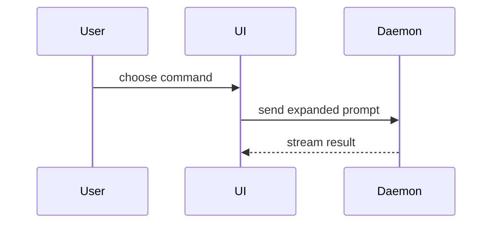

Help the user understand the current topic of conversation visually. Skip the preamble and keep prose brief. Pick the smallest view that makes the key point clear.

- Compare a few values or options in a compact table. Use a chart when the point depends on a trend, distribution, or spatial relationship.

- Show logic or an algorithm as pseudocode:

```text
on(save)
  if content is unchanged
    return cached result
  write new content
  return fresh result
```

- Show runtime control flow as a call tree:

```text
submitForm
  createSession
    persistPrompt
    launchAgent
  navigateToSession
```

- Show UI structure as a component tree, including state and module boundaries that matter:

```tsx
<SessionPage> (apps/example/src/routes/session.tsx)
  useSessionEvents()
  <SessionToolbar>
    <RunSkillButton> (packages/ui)
```

- Show file responsibility or a broad refactor as a shallow file tree:

```text
src/
├── commands/       # parses user actions
├── sessions/       # owns session state
└── transport/      # sends API requests
```

- Show component interaction, control flow, or data flow with Mermaid. When specific syntax or configuration needs help, consult [mermaid-diagrams](https://github.com/softaworks/agent-toolkit/tree/HEAD/skills/mermaid-diagrams) or the host renderer's documentation:



- Use `diff` when the point is what changes and the surrounding shape already exists. Match the diff shape to the topic; mark only actual changes and keep unchanged context neutral.

For a component change:

```diff
 <SessionPage>
   useSessionEvents()
   <SessionToolbar>
+    <RunSkillButton />
   <SessionTimeline>
+    <SkillResultCard />
```

For a file-layout change:

```diff
 src/
 ├── commands/
+│   └── show-me.ts       # expands the slash command
 ├── sessions/
-└── transport.ts
+└── transport/
+    ├── client.ts
+    └── stream.ts
```

For a call-tree or call-stack change:

```diff
 submitForm
   createSession
     persistPrompt
+    expandSkillMention
     launchAgent
-  navigateToSession
+  navigateToSession
+    subscribeToEvents
```

For a state or control-flow change:

```diff
 on(save)
-  write content
+  if content is unchanged
+    return cached result
+  write new content
+  invalidate cache
```

- Show the whole block when most of it is new, when omitted context would hide ownership or order, or when the user needs a copyable target shape:

```ts
function expandSkill(command: string): string {
  const skillName = command.slice(1)
  return `use the ${skillName} skill`
}
```

- Use HTML when requested, or when understanding needs visual layout, interaction, or coordinated views that an inline table, tree, or Mermaid diagram cannot provide. Write one focused HTML file — a diagram, an infographic, or a short slide deck, whichever fits the point. Match the product's colors, type, spacing, and components; use real labels and data; support desktop and mobile. Preview or open it with the host's available tools when supported and consistent with the user's preferences; otherwise provide a link.

  Once HTML is chosen, prefer [answer-me-with-html](https://github.com/QingYunA/answer-me-with-html/tree/HEAD/skills/answer-me-with-html). Keep the page focused on the current question; let the content determine the number of panels. If its components cannot express the required layout or interaction, or the tool is unavailable, generate the HTML directly.

### guidance

Place each visual next to the short text it supports. Keep only the calls, files, props, states, and boundaries needed to answer the user's current question or the options to resolve the current discussion point.

Default to one primary view. Add another only when it answers a different question; stop when the current question is answered.

For complex topics, start with an overview of the key boundaries and relationships, then expand the relevant details. Put detail in the view where it is needed rather than fitting every node and connection into the overview.

### extensions

- Put conditions, quantity limits, and direction that affect the answer on the relevant nodes or connections; supporting prose must agree with the graphic. Distinguish facts, proposals, and unknowns. When simplifying conditions, ordering, boundaries, cardinality, or scales could change their meaning, consult the relevant [semantic guidance](references/semantics.md).
- For precise connector routing, a specific visual style, or diagram import/export, use [diagram-design](https://github.com/cathrynlavery/diagram-design/tree/HEAD/skills/diagram-design) when its workflow fits the task. User-specified tools take priority. For data charts needing exact scales, use a standard plotting library.
- Respect the requested format and destination; use a form the host can display. At reading size, check that the main graphic is legible, legends match the marks, and key rules are readable with the relationships they constrain. Check interactions, narrow screens, offline use, or exports when required. Provide a viewable artifact and editable source for file deliverables; briefly disclose any rendering or visual checks you could not perform.

These skills are optional. Prefer existing installations; read only the selected skill's `SKILL.md` and relevant references, following its installed commands and runtime requirements. Keep the chosen format, scope, and deliverables; use another implementation if the extension's workflow conflicts. If missing, install only the needed skill when already authorized, respecting the host's rules and user-specified versions and locations; otherwise use available tools. Explain any limitation affecting a user-requested tool.

Based on [show-me](https://github.com/humanlayer/skills/blob/bba9d13ab34f0a87f1cc33df4dd196372393ddfc/plugins/show-me/skills/show-me/SKILL.md). Its [MIT license](LICENSE.show-me) is included.
