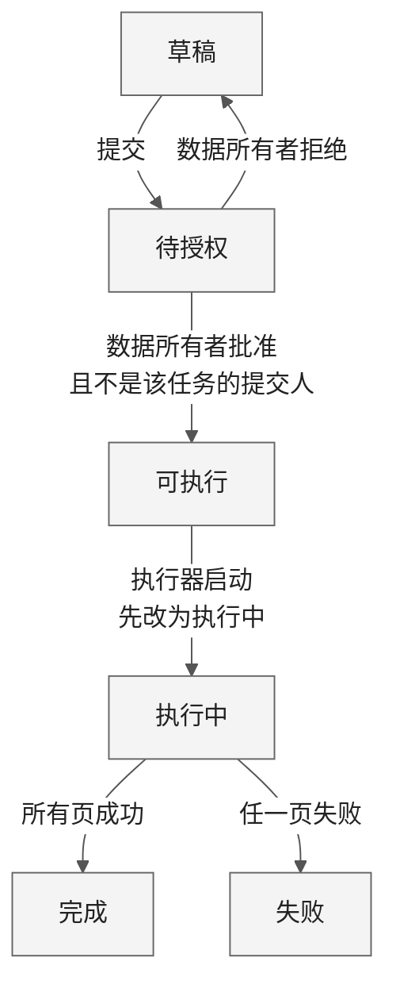
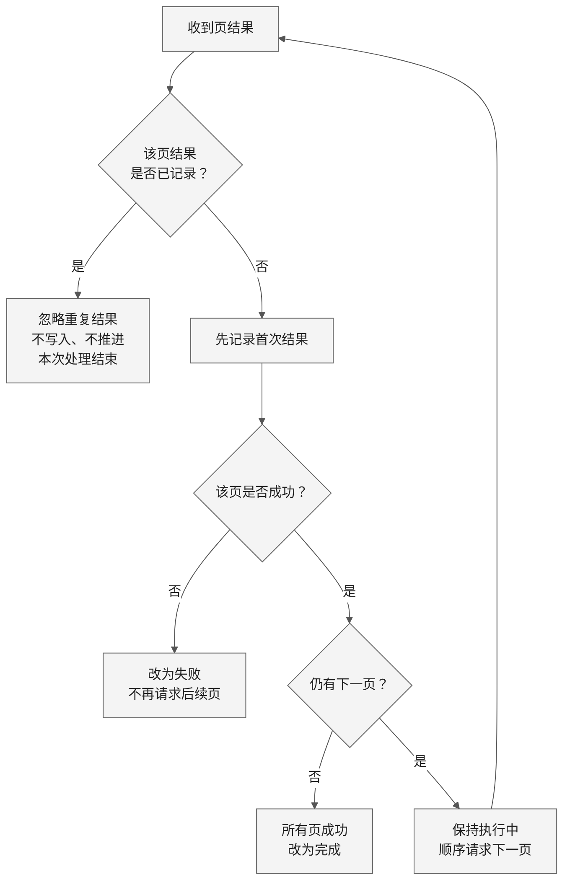
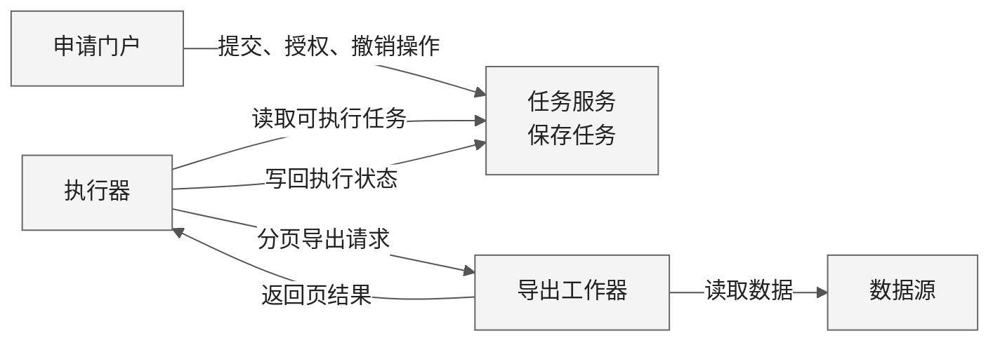

保留三幅可编辑 Mermaid 图：**任务状态、分页去重、组件协作**。画布自适应，建议阅读宽度 900–1100 px。

已查看实际画面：连线未遮挡关键内容；分页图部分文字折行较碎，本次缩短了两个节点的文案。**状态图、协作图沿用已检查版本；分页图的新文案尚未渲染检查。**

### 1. 任务状态与停止边界

| 边界 | 规则 |
|---|---|
| 创建 | 任务创建为草稿。 |
| 授权 | 申请人可以同时是数据所有者，但不能授权自己提交的同一任务。 |
| 撤销 | **仅可执行任务可撤销**；撤销后的状态未提供。 |
| 执行 | **一旦执行中，不能撤销**。 |
| 失败 | 不再请求后续页；已经导出的页不会自动删除。 |

### 2. 分页去重：首次结果才参与推进

执行器只启动可执行任务，**先改为执行中，再按顺序发送分页导出请求**。收到页结果后，先去重，再决定是否推进。

- **重复结果**：忽略，不重复写入，也不推进分页。“本次处理结束”仅指当前结果处理结束，不表示任务结束。
- **首次结果**：先记录，再判断该页是否成功；成功且仍有下一页才继续请求。
- **失败停止**：任一页失败就改为失败，不再请求后续页；已经导出的页不会自动删除。

### 3. 组件协作

箭头表示操作或数据交互，不指定传输机制。输入未提供**授权检查的实现位置、请求标识传递、事务边界、数据库、队列、自动重试、超时及失败后的恢复方案**，图中均未补设。