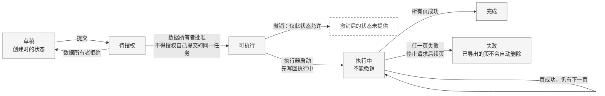
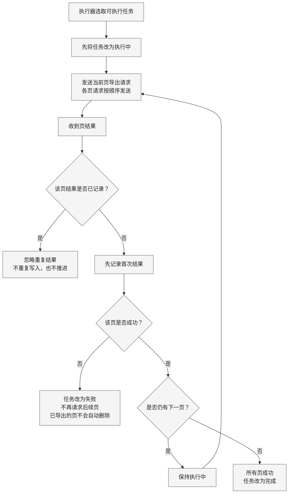

采用两张可编辑 Mermaid 图：**任务状态图**与**分页处理图**，另用表格说明组件交互。画布随内容自适应，建议阅读宽度约 900 px；使用中性色和系统字体。

### 1. 任务状态与停止边界

申请人可以同时是数据所有者，但**不能授权自己提交的同一任务**。执行器只启动“可执行”任务；进入“执行中”后，撤销入口关闭。

### 2. 分页顺序与结果去重

“忽略重复结果”只结束这次重复结果的处理，**不代表任务失败或完成**。首次结果先记录，再判断成功或失败；只有成功且存在下一页，才继续请求。

### 3. 组件之间如何交互

| 发起方 | 目标 | 已知交互 |
|---|---|---|
| 申请门户 | 任务服务 | 发送提交、授权、撤销操作 |
| 任务服务 | — | 保存任务 |
| 执行器 | 任务服务 | 读取可执行任务，写回执行状态 |
| 执行器 | 导出工作器 | 按顺序发送分页导出请求 |
| 导出工作器 | 数据源 | 读取数据 |
| 导出工作器 | 执行器 | 返回页结果 |

**未提供的实现细节：**授权检查位置、请求标识传递、事务边界、数据库、队列、自动重试、超时及失败后的恢复方案。图中不推定这些机制，也不补设去重键或撤销后的状态。