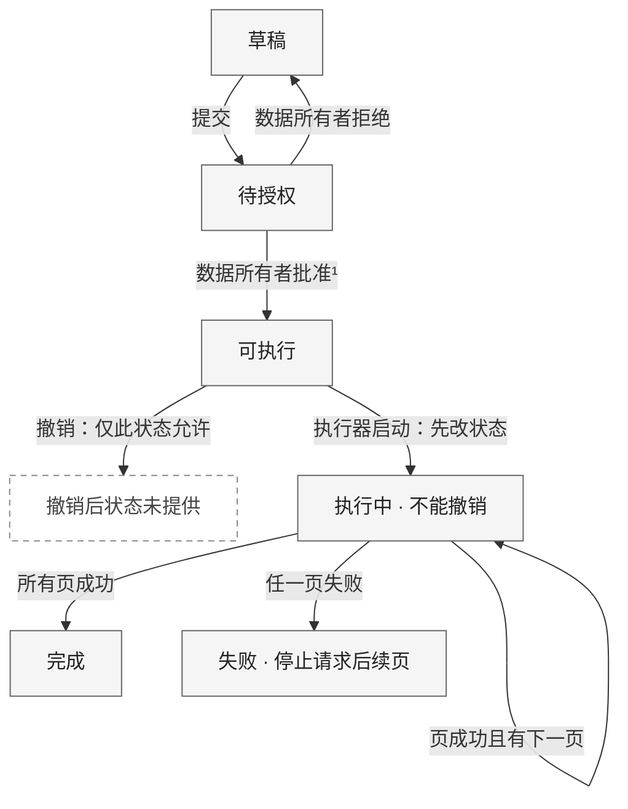
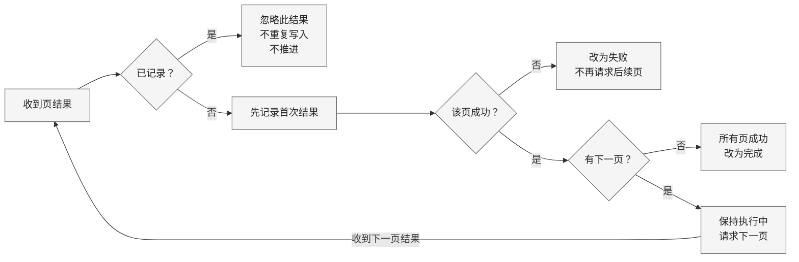

保留两张可编辑 Mermaid 图：**状态与停止边界**改为纵向，**分页去重**改为横向，减少长窄图和文字折行。建议阅读宽度分别约 800 px、1100 px；实际尺寸由渲染器自适应。

### 1. 状态与停止边界

任务创建时为**草稿**。¹申请人可以同时是数据所有者，但不能授权自己提交的同一任务。

**停止边界：**仅“可执行”任务可撤销；一旦进入“执行中”，不能撤销。任一页失败后，不再请求后续页，已经导出的页不会自动删除。

### 2. 分页结果：先去重，再判断，再推进

执行器只启动“可执行”任务，**先将任务改为执行中，再发送第一页请求**。后续页按顺序请求，每次收到页结果都进入下图。

“忽略”只结束**这次重复结果**的处理，不改变任务状态，也不触发下一页请求。首次结果先记录；只有该页成功且仍有下一页，才继续导出。

### 3. 组件职责与交互方向

| 发起方 → 目标 | 操作或信息 |
|---|---|
| 申请门户 → 任务服务 | 提交、授权、撤销操作 |
| 任务服务 | 保存任务 |
| 执行器 → 任务服务 | 读取可执行任务；写回执行状态 |
| 执行器 → 导出工作器 | 按顺序发送分页导出请求 |
| 导出工作器 → 数据源 | 读取数据 |
| 导出工作器 → 执行器 | 返回页结果 |

**未提供的细节：**授权检查的实现位置、请求标识传递、事务边界、数据库、队列、自动重试、超时及失败后的恢复方案。因此，图中不指定去重键、存储机制或恢复路径。