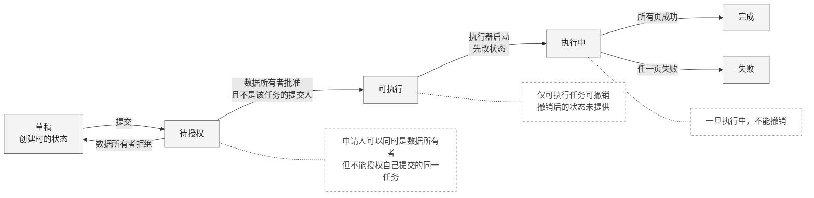
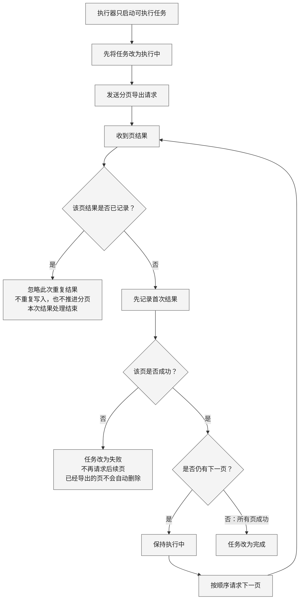
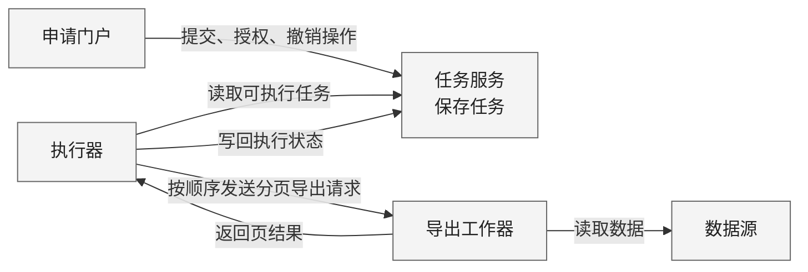

采用三幅可编辑 Mermaid 图：**任务状态、分页与去重、组件协作**。画布随内容自适应；建议阅读宽度约 900–1100 px。以下为待渲染草稿。

### 1. 任务状态与停止边界

**授权资格看的是同一任务的提交人**：即使申请人也是数据所有者，也不能批准自己提交的任务。虚线连接为规则说明，不代表状态迁移。

### 2. 分页处理：先去重，再判断是否推进

**重复结果只结束此次结果处理**，不表示任务完成或失败。只有首次结果参与成功／失败判断与分页推进；任一页失败后，停止请求后续页，已导出内容保留。

### 3. 组件协作与职责

图中箭头表示操作或数据交互，不指定传输机制。**尚未提供**：授权检查的实现位置、请求标识传递、事务边界、数据库、队列、自动重试、超时，以及失败后的恢复方案；这些均未补设。