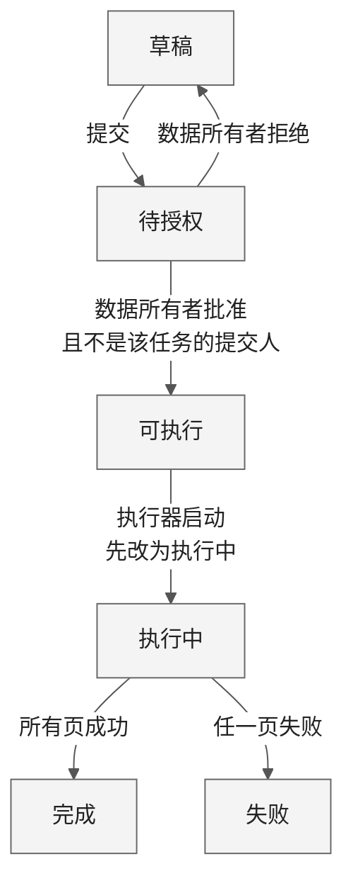
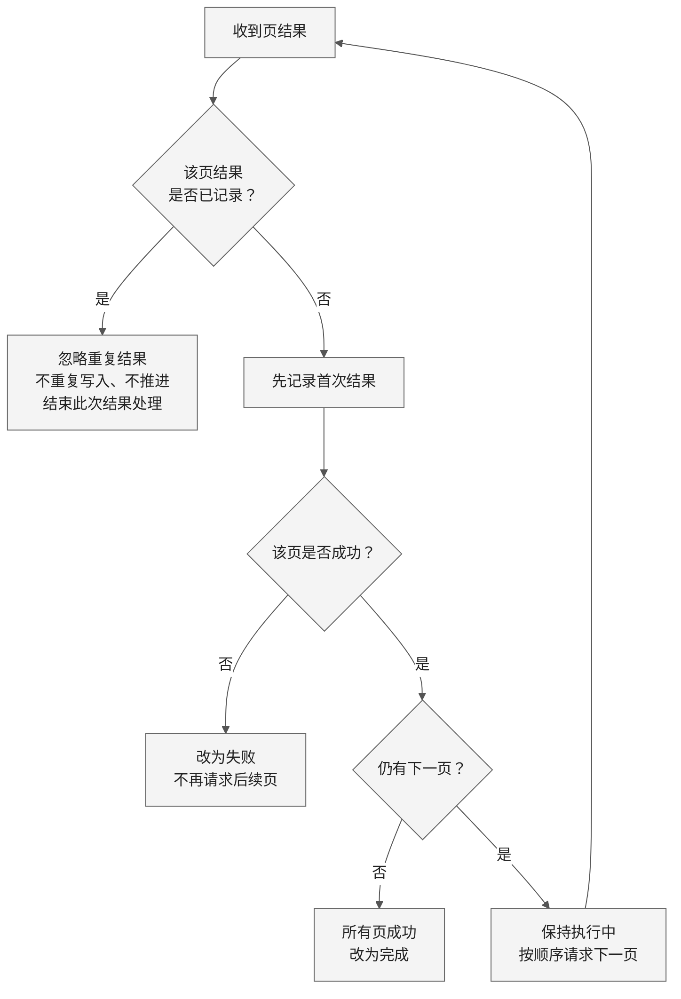
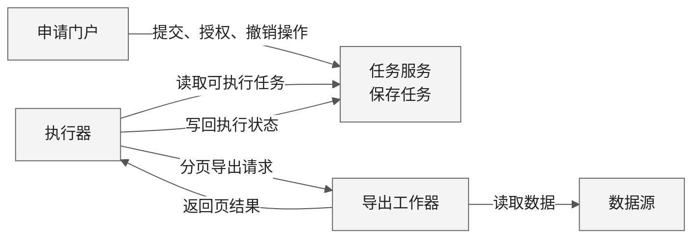

采用三幅可编辑 Mermaid 图：**状态、分页去重、组件协作**，宽度自适应，建议阅读宽度 900–1100 px。根据实际渲染，已将状态图改为纵向、缩短分页主链，并把较长的规则说明移到图旁，减少文字折行。

### 1. 状态与停止边界

| 边界 | 规则 |
|---|---|
| 创建 | 任务创建为草稿。 |
| 授权 | 申请人可以同时是数据所有者，但不能授权自己提交的同一任务。 |
| 撤销 | 仅可执行任务可撤销；撤销后的状态未提供。 |
| 执行 | 一旦执行中，不能撤销。 |
| 失败 | 不再请求后续页；已经导出的页不会自动删除。 |

### 2. 分页去重：首次结果才参与推进

执行器**只启动可执行任务，先改为执行中，再发送分页导出请求**。请求按顺序发送，收到页结果后按下图处理。

“结束此次结果处理”仅指忽略当前重复结果，不表示任务结束。**去重判断在前，首次结果先记录**，随后才判断成功、失败及是否请求下一页。失败后已导出的页不会自动删除。

### 3. 组件协作

箭头表示操作或数据交互，不指定传输机制。输入未提供**授权检查的实现位置、请求标识传递、事务边界、数据库、队列、自动重试、超时及失败后的恢复方案**，图中均未补设。

上一版已实际渲染检查；本次调整后的源码尚待渲染验证。