# visual-explanation_2与 0.4.2：新案例实测

**这轮去重题基本相当；复杂题中新版更便于沿图追踪关系，0.4.2 的单页 HTML 更集中，并保留了已检查的最终稿。** 两版关键事实、顺序和失败边界均正确，未发现实质误导。

去重：均用一张流程图加逐条表，正确给出保存3次、ACK4次；旧Grok结果的计数错误没有复现，不能把它解释成新版指令已修复错误。

复杂平台：新版用四阶段总览及分段时序展示成功路径、查询和通知，最终8张局部图；0.4.2用区域单元清单、完整操作表、状态图及失败速查表，HTML含2张SVG。前者更直接看到谁调用/读写谁，后者更适合单页找单元与失败状态。两版都保留14内部单元、全部18对通信端点，不编造索引失败后必然不可查询。

本次复杂题三次调用输出token：新版10935，0.4.2为25346；最终原始回复3760与9449字符。不同交付格式、全文回传和单样本影响用量，不能当作普遍维护成本或稳定效率优势。

**若优先看关系图，我更倾向这轮新版的表达方式；不足以判定它全面优于0.4.2。** 新版最后仍改图并如实标未检查，0.4.2保持已检查的最终HTML。可选扩展均不可用，本轮不证明am或其他后端的接入效果。没有修改任一Skill。

每版两题、四条独立容器/会话轨迹，每条两次真实桌面图片反馈。相同模型；两题均允许 Mermaid 或离线 HTML/SVG。可选扩展均不可用，测试回退路径。详见 [协议与限制](README.md)。

## 产出规模

| 题目 | Skill | 最终图数 | 原生格式 | 图源码字符 | 全部代码块字符 | 三次调用输出 tokens | 最后反馈后仍改图 |
|---|---|---:|---|---:|---:|---:|---|
| 01-dedup | visual-explanation 0.4.2 | 1 | Mermaid | 462 | 462 | 3,370 | 否，模型已收到相同图源码的画面 |
| 01-dedup | visual-explanation_2 | 1 | Mermaid | 339 | 339 | 2,972 | 否，模型已收到相同图源码的画面 |
| 02-overview | visual-explanation 0.4.2 | 2 | HTML/SVG | 9,358 | 9,358 | 25,346 | 否，模型已收到相同图源码的画面 |
| 02-overview | visual-explanation_2 | 8 | Mermaid | 2,098 | 2,098 | 10,935 | 是，最终画面由评审查看 |

图数按实际主 SVG/Mermaid 图计数，一份 HTML 可能含多图；伪代码不计作图片，但计入全部代码块。HTML 包含页面样式、文字与表格，Mermaid 源不含外围 Markdown，因此源码字符只反映各自交付物规模。token 是本轮 CLI 用量，含修订，不代表价格或正常按需读取的最低消耗。未测真实需求变更工时。

## 去重规则与保存、ACK 计数

两版均符合核心目标，处理分支和保存3/ACK4可直接找回，理解效果基本相当。没有图数或表达形式的实质差别。

### visual-explanation 0.4.2

[最终原始回答](outputs/v042/01-dedup.md) · [初稿](trajectories/v042/01-dedup/stage0/answer.md) · [第一次修订](trajectories/v042/01-dedup/stage1/answer.md) · [最终阶段](trajectories/v042/01-dedup/stage2/answer.md)

**内容：** 完整三字段去重键、乱序允许、新启动周期、新键保存后ACK、重复仅ACK、保存失败不记录且不ACK均保留。示例逐条1/1、1/1、0/1、1/1，合计保存3、ACK4。

**忠实性：** 不新增持久化后端、序号连续性、并发或协议要求。失败后仍按首次处理说明清楚。

**实际画面：** 一张横向流程图加逐条表，两个判断的分支连续可追踪、节点文字清楚。图内含较长失败说明，整体稍高；不影响理解。

**检查闭环：** 最终图源与模型收到的stage1图片相同，已实际渲染查看。

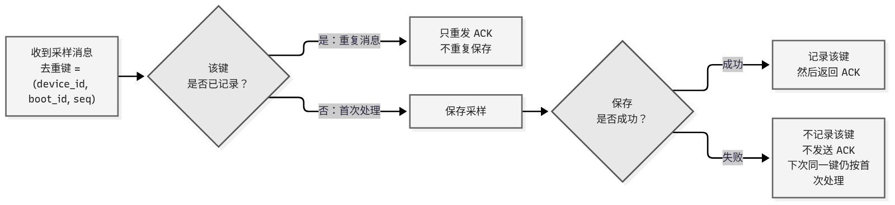

[可编辑 Mermaid](trajectories/v042/01-dedup/render-inputs/stage1-1.mmd) · [SVG](trajectories/v042/01-dedup/rendered/stage1-1.svg)

查看初稿实际画面

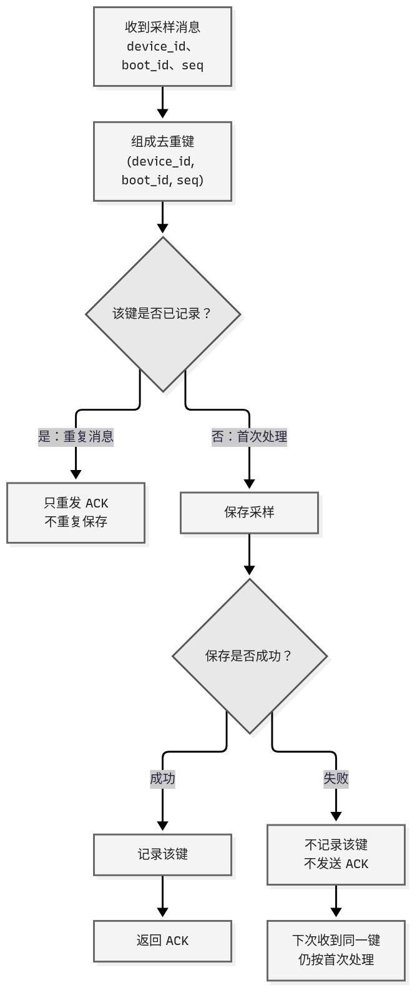

### visual-explanation_2

[最终原始回答](outputs/candidate/01-dedup.md) · [初稿](trajectories/candidate/01-dedup/stage0/answer.md) · [第一次修订](trajectories/candidate/01-dedup/stage1/answer.md) · [最终阶段](trajectories/candidate/01-dedup/stage2/answer.md)

**内容：** 与0.4.2相同关键规则和正确计数，三字段去重、乱序与boot_id范围都清楚。

**忠实性：** 没有复现另一模型历史保存4次的错误；这不能证明靠新版规则修复了该问题。

**实际画面：** 同样一张横向流程图加逐条表；图内失败节点更短，后续首次处理规则放正文。线条较淡但仍可追踪，未见影响理解的遮挡。

**检查闭环：** 最终图源与已反馈stage1相同。

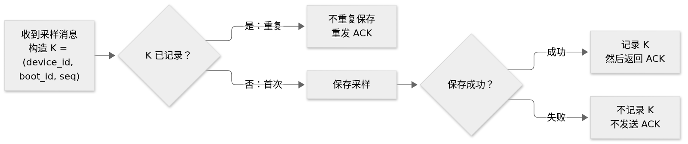

[可编辑 Mermaid](trajectories/candidate/01-dedup/render-inputs/stage1-1.mmd) · [SVG](trajectories/candidate/01-dedup/rendered/stage1-1.svg)

查看初稿实际画面

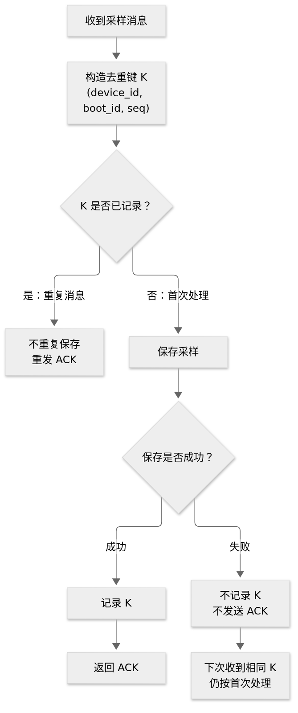

## 14 单元平台：总览与失败影响

两版均符合核心目标，无实质遗漏或无依据保证。偏重新人沿图追踪处理/查询关系，本样本新版更直观；偏重单页单元归属与失败速查，0.4.2页面更集中。新版用更多局部图，但原生交付更短、输出token较少；0.4.2保持已检查的最后图源，检查闭环更完整。不能把格式或源码规模差直接归因为某条规则。

### visual-explanation 0.4.2

[最终原始回答](outputs/v042/02-overview.md) · [初稿](trajectories/v042/02-overview/stage0/answer.md) · [第一次修订](trajectories/v042/02-overview/stage1/answer.md) · [最终阶段](trajectories/v042/02-overview/stage2/answer.md)

**内容：** 同样14内部单元、外部邮件服务和18对已知通信端点，全部已知操作/顺序在八行明细表中保留；成功状态链及三失败分支的状态、责任和保留/重试约束完整。

**忠实性：** 读操作按数据源→读取者，调用/写入按执行者→目标，并明确解释约定。索引失败后的部分写入及搜索可见性保持未知；不发明协议、部署、队列或恢复入口。

**实际画面：** 一份HTML中有2张SVG（区域单元清单、状态/失败图）及2张表，不是仅两种视图。区域图适合找单元归属，成功关系主要由文字箭头表格解释；新人想追主链需读表，直观追关系不如新版分段时序。失败状态图及速查表较集中清楚。完整桌面页2683px高；手机正文正常，SVG及表格局部横向滚动。

**检查闭环：** 修正失败标签位置后，最终HTML/图源保持已反馈stage1相同。生成器看到完整桌面页和两张SVG，评审另看移动图；没有模型看过手机的记录。自检返回通过，几何脚本忽略CSS箭头，不用它证明连线全检查。

[可编辑 HTML](trajectories/v042/02-overview/render-inputs/stage1-1.html) · [完整桌面页](trajectories/v042/02-overview/rendered/stage1-1-desktop.png) · [移动截图](trajectories/v042/02-overview/rendered/stage1-1-mobile.png)

GitHub 不直接执行 HTML；下载 HTML 后用浏览器打开即可查看原生页面。

查看初稿实际画面

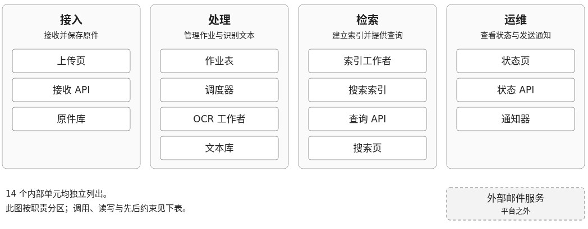

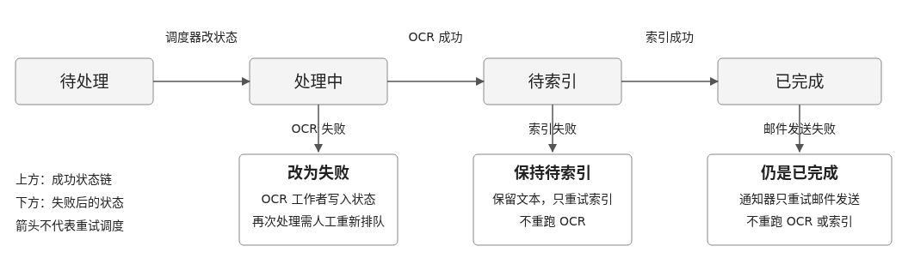

### visual-explanation_2

[最终原始回答](outputs/candidate/02-overview.md) · [初稿](trajectories/candidate/02-overview/stage0/answer.md) · [第一次修订](trajectories/candidate/02-overview/stage1/answer.md) · [最终阶段](trajectories/candidate/02-overview/stage2/answer.md)

**内容：** 14个内部单元及外部邮件服务、18对已知通信端点均在明细中保留；读取/写入、先改状态再派发、文本写入再推进状态/通知索引、索引成功才已完成均准确。OCR/索引/邮件三条失败状态、保留结果和重试边界完整。

**忠实性：** 不补设部署、协议、队列、重试调度或人工入口。把索引失败后的搜索可见性留为不保证/具体内容未知，没有虚构索引成功前一定不可查询的保证。成功总览说明是业务推进，不把阶段关系当具体服务调用。

**实际画面：** 初稿15主体全量总览较高，交叉及回连增加追踪负担；反馈后变为四阶段总览、三段处理时序、两条查询路径、通知时序和状态图共8张图，职责表另列14单元。可直接追踪每步的发起者和目标；分图较多，需要在章节间跳转，不能按图数多或少决定质量。最终图面可读，无实质遮挡。

**检查闭环：** 最后反馈后又缩短总览标签、拆查询/通知视图并调整失败图；明确说修改后尚未查看。评审独立实际渲染并查看8张最终图。

[可编辑 Mermaid](trajectories/candidate/02-overview/render-inputs/stage2-1.mmd) · [SVG](trajectories/candidate/02-overview/rendered/stage2-1.svg)

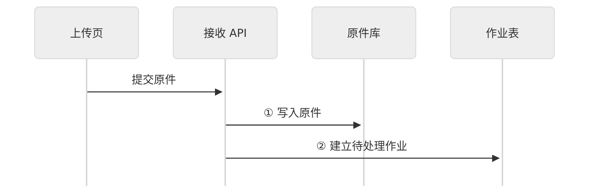

[可编辑 Mermaid](trajectories/candidate/02-overview/render-inputs/stage2-2.mmd) · [SVG](trajectories/candidate/02-overview/rendered/stage2-2.svg)

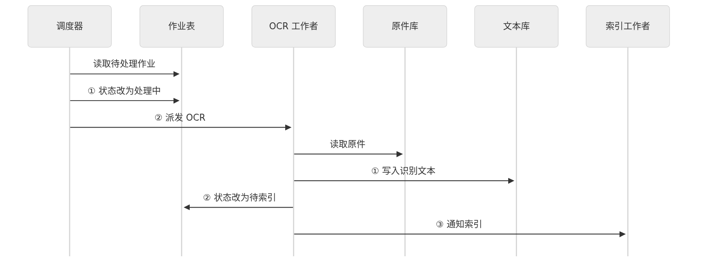

[可编辑 Mermaid](trajectories/candidate/02-overview/render-inputs/stage2-3.mmd) · [SVG](trajectories/candidate/02-overview/rendered/stage2-3.svg)

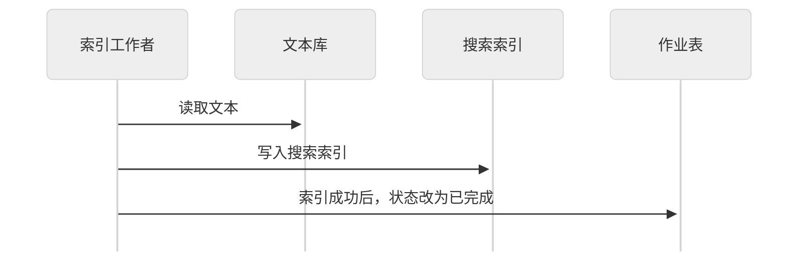

[可编辑 Mermaid](trajectories/candidate/02-overview/render-inputs/stage2-4.mmd) · [SVG](trajectories/candidate/02-overview/rendered/stage2-4.svg)

[可编辑 Mermaid](trajectories/candidate/02-overview/render-inputs/stage2-5.mmd) · [SVG](trajectories/candidate/02-overview/rendered/stage2-5.svg)

[可编辑 Mermaid](trajectories/candidate/02-overview/render-inputs/stage2-6.mmd) · [SVG](trajectories/candidate/02-overview/rendered/stage2-6.svg)

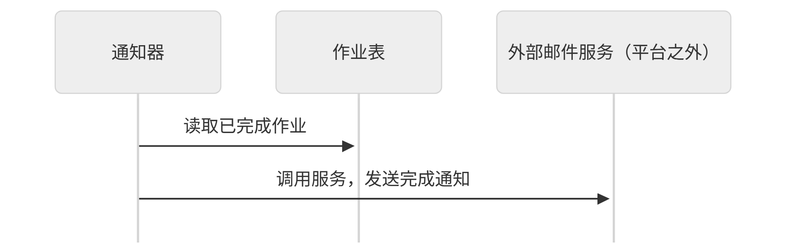

[可编辑 Mermaid](trajectories/candidate/02-overview/render-inputs/stage2-7.mmd) · [SVG](trajectories/candidate/02-overview/rendered/stage2-7.svg)

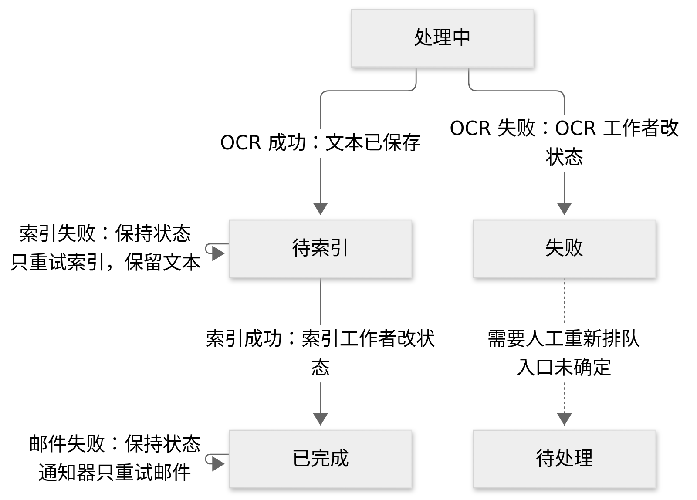

[可编辑 Mermaid](trajectories/candidate/02-overview/render-inputs/stage2-8.mmd) · [SVG](trajectories/candidate/02-overview/rendered/stage2-8.svg)

查看初稿实际画面

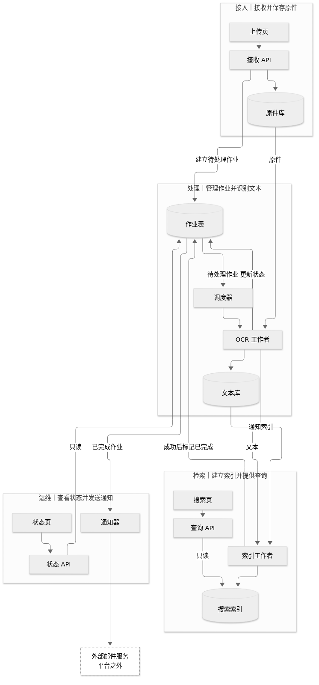

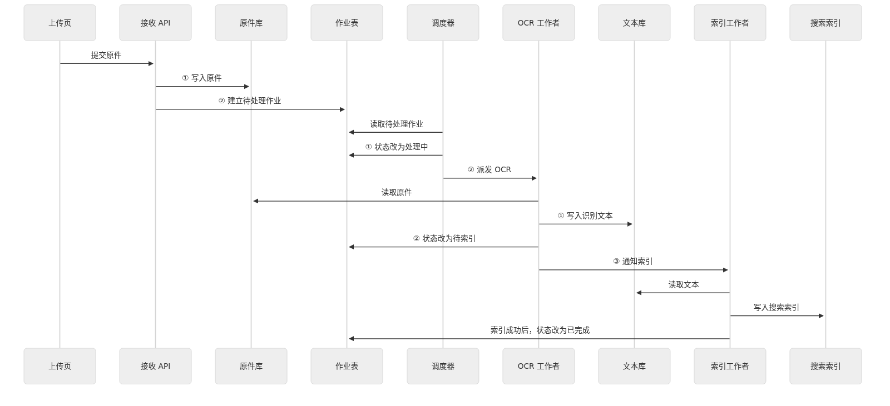

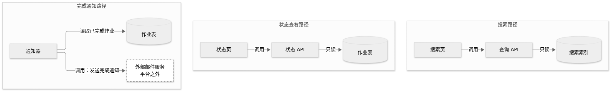

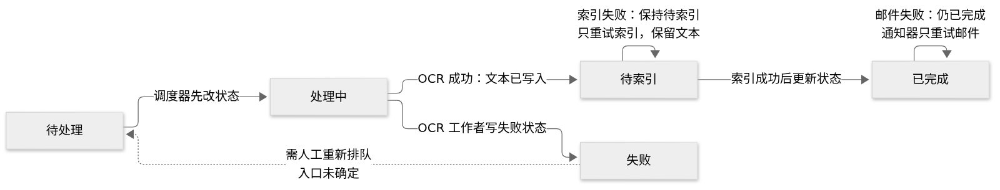

## 证据与限制

四条轨迹独立容器、独立会话、无其他组输出挂载；各阶段实际模型与源码哈希见 [runs.json](runs.json)。生成不调用工具，渲染由控制器完成，不测客户端自动加载。每题每组一个样本，主 Agent 知道组别后评审；不能据此宣布普遍排名。

[内容评审](content-review.json) · [用量与修订规模](metrics.json) · [Mermaid 语法检查](syntax-results.json) · [输入及输出完整性](integrity-results.json)

本轮没有测试 am、diagram-design 或 mermaid-diagrams 的原生接入；不用未加载的工具为输出背书。渲染成功不是语义或理解效果证明；具体问题以原始材料、源码与实际画面为依据。
