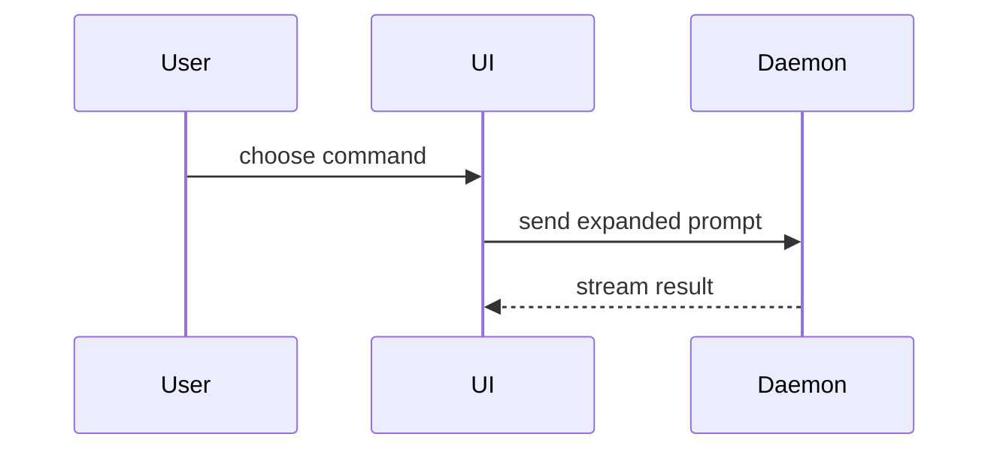

Help the user understand the current topic visually, in conversation or a document. Skip the preamble and keep prose brief. Pick the smallest view that makes the key point clear.

- Compare a few values or options in a compact table. Use a chart when the point depends on a trend, distribution, or spatial relationship. For data charts needing exact scales, use a standard plotting library.

- Show logic or an algorithm as pseudocode:

```text
on(save)
  if content is unchanged
    return cached result
  write new content
  return fresh result
```

- Show runtime control flow as a call tree:

```text
submitForm
  createSession
    persistPrompt
    launchAgent
  navigateToSession
```

- Show UI structure as a component tree, including state and module boundaries that matter:

```tsx
<SessionPage> (apps/example/src/routes/session.tsx)
  useSessionEvents()
  <SessionToolbar>
    <RunSkillButton> (packages/ui)
```

- Show file responsibility or a broad refactor as a shallow file tree:

```text
src/
├── commands/       # parses user actions
├── sessions/       # owns session state
└── transport/      # sends API requests
```

- Show relationships, sequences, states, or flows with Mermaid. When specific syntax or configuration needs help, consult [mermaid-diagrams](https://github.com/softaworks/agent-toolkit/tree/HEAD/skills/mermaid-diagrams) or the host renderer's documentation:



- Use `diff` when the point is what changes and the surrounding shape already exists. Match the diff shape to the topic; mark only actual changes and keep unchanged context neutral.

For a component change:

```diff
 <SessionPage>
   useSessionEvents()
   <SessionToolbar>
+    <RunSkillButton />
   <SessionTimeline>
+    <SkillResultCard />
```

For a file-layout change:

```diff
 src/
 ├── commands/
+│   └── show-me.ts       # expands the slash command
 ├── sessions/
-└── transport.ts
+└── transport/
+    ├── client.ts
+    └── stream.ts
```

For a call-tree or call-stack change:

```diff
 submitForm
   createSession
     persistPrompt
+    expandSkillMention
     launchAgent
-  navigateToSession
+  navigateToSession
+    subscribeToEvents
```

For a state or control-flow change:

```diff
 on(save)
-  write content
+  if content is unchanged
+    return cached result
+  write new content
+  invalidate cache
```

- Show the whole block when most of it is new, when omitted context would hide ownership or order, or when the user needs a copyable target shape:

```ts
function expandSkill(command: string): string {
  const skillName = command.slice(1)
  return `use the ${skillName} skill`
}
```

- Use [diagram-design](https://github.com/cathrynlavery/diagram-design/tree/HEAD/skills/diagram-design) for a diagram that needs deliberate spatial arrangement of groups, boundaries, and connections beyond what a standard layout communicates clearly, or a specific visual style or diagram import/export. Follow its workflow when it fits the chosen scope and delivery format; complexity alone does not require it.

- Use HTML when requested, or when understanding needs visual layout, interaction, or coordinated views that an inline table, tree, or Mermaid diagram cannot provide. Write one focused HTML file — a diagram, an infographic, or a short slide deck, whichever fits the point. Match the surrounding document or product's visual style when available; use real labels and data. Open it with the host's available tools when supported and consistent with the user's preferences; otherwise provide a link.

  For an HTML explanation page combining diagrams, tables, code, or prose, prefer [answer-me-with-html](https://github.com/QingYunA/answer-me-with-html/tree/HEAD/skills/answer-me-with-html) when its existing components directly fit the content. For custom charts, layouts, or interactions that would require substantial template adaptation, or when the tool is unavailable, generate the HTML directly. Let the content determine the number of panels.

### guidance

Place each visual next to the short text it supports. Keep the entities, relationships, conditions, and boundaries needed to answer the user's current question or compare the options under discussion.

In a long document, visualize relationships the reader would otherwise have to assemble from several passages. Place the diagram in the relevant section and let prose carry details that are clearer in words; preserve the document's requested format.

Start with the view that answers the user's main question. Add a view only for a requested aspect that would otherwise remain unclear.

For complex topics, group the overview by meaningful boundaries and place detailed relationships where they are explained.

### extensions

- Simplify the presentation while preserving relationships and constraints that affect the answer; distinguish supplied facts from assumptions.
- Respect the requested format and destination; use a form the host can display. An editable HTML or SVG file can serve as both the viewable artifact and its source; provide additional exports when requested or needed for viewing. Verify the actual deliverables against user-required interactions, screen sizes, offline use, or exports; disclose any requirement you could not verify. Once the content is accurate, readable, and meets the requested behavior and format, deliver it; revise further when a concrete defect remains.

These skills are optional implementation aids. Choose the view, scope, and delivery format first; use the selected skill to implement those choices. User-specified tools take priority. Prefer existing installations; read only the selected skill's `SKILL.md` and relevant references, following its installed commands and runtime requirements. Reuse the host's or installed rendering tools when they support the chosen format. Use another implementation if the extension's workflow conflicts. If missing, install only the needed skill when already authorized, respecting the host's rules and user-specified versions and locations; otherwise use available tools. Explain any limitation affecting a user-requested tool.

Based on [show-me](https://github.com/humanlayer/skills/blob/bba9d13ab34f0a87f1cc33df4dd196372393ddfc/plugins/show-me/skills/show-me/SKILL.md). Its [MIT license](LICENSE.show-me) is included.
