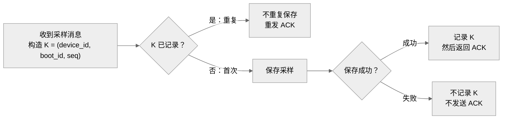

采用**横向处理流程图 + 逐条判定表**。已查看实际渲染：约 **1600 × 340 px**，分支及文字清晰；以下保留已检查的图源码。

去重键是 **`K = (device_id, boot_id, seq)`**，三者必须一起比较。首次收到时，**先保存成功，再记录 K 并返回 ACK**。

保存失败后，相同 K 再次到达时仍按首次处理。**seq 允许乱序、不要求连续**；设备重启生成不同的 `boot_id`，因此新启动周期可以再次使用 `seq=1`。

| 收到顺序 | 去重键 K | 判定与处理 | 成功保存次数 | ACK 次数 |
|---|---|---|---:|---:|
| 1 | `(D1, b7, 2)` | 新键，保存成功后返回 ACK | 1 | 1 |
| 2 | `(D1, b7, 1)` | 新键；乱序不影响处理 | 1 | 1 |
| 3 | `(D1, b7, 2)` | 重复键，只重发 ACK | 0 | 1 |
| 4 | `(D1, b8, 1)` | 启动周期改变，是新键 | 1 | 1 |
| **合计** | **3 个不同的键** | | **3** | **4** |

此例共执行 **3 次保存，全部成功；发送 4 次 ACK**。