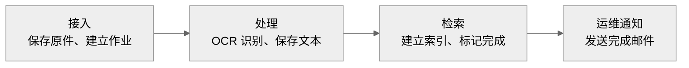
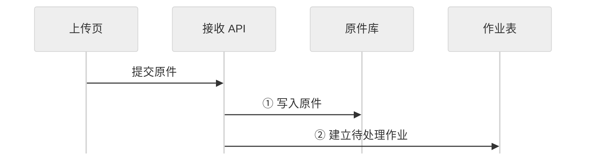
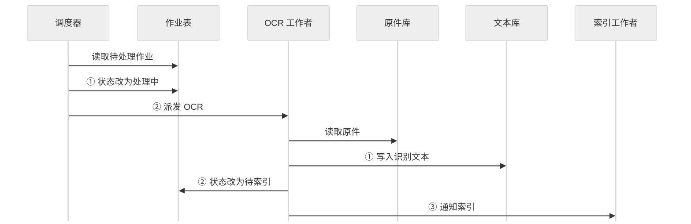
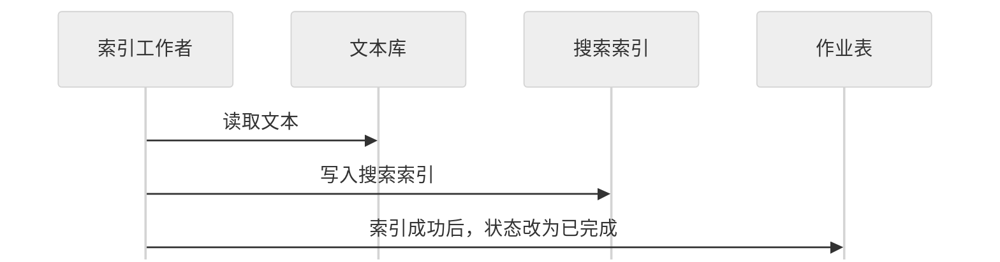
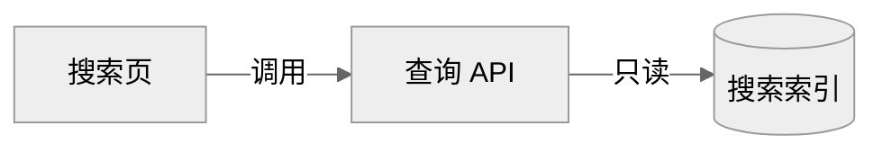
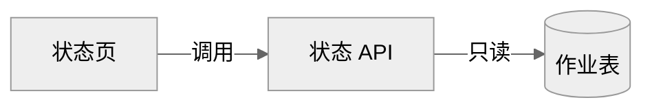
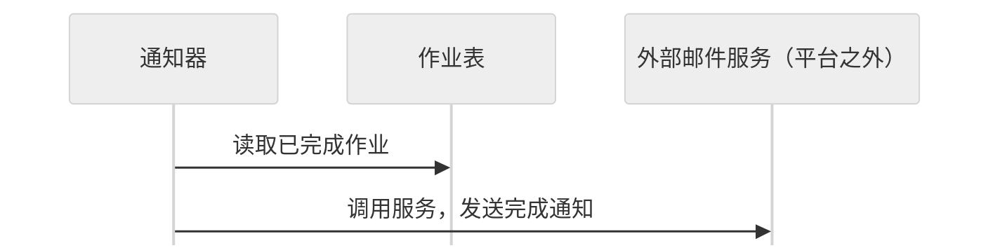
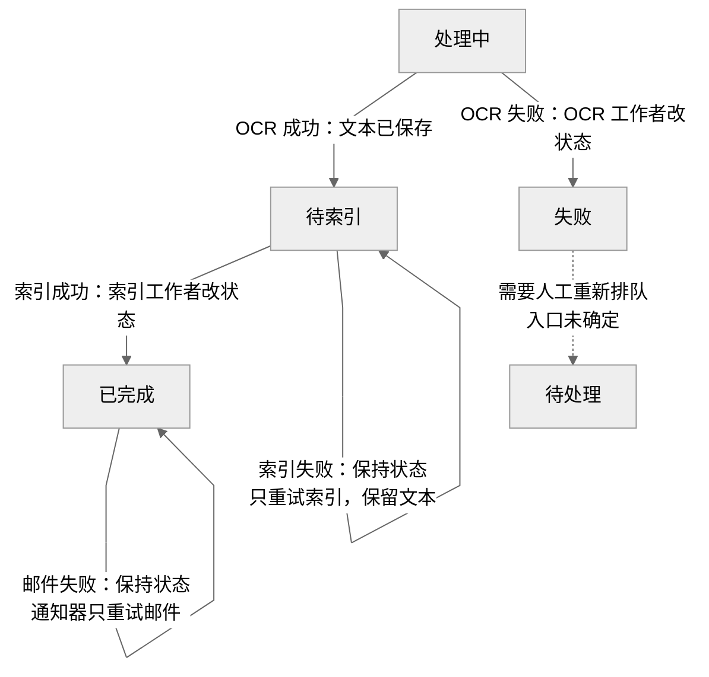

采用 **Markdown + 可编辑 Mermaid**：业务总览、分段处理时序、查询与通知路径，以及失败影响速查。建议展示宽度 **1000 px**，高度自适应，使用中性色和系统字体。

已看到上一稿的全部渲染：处理时序清楚，但总览文字换行较碎，失败图存在孤立说明框。本稿缩短总览标签，将失败说明集中到对照表；**修改后的图尚未再次渲染检查**。

## 1. 全貌：从原件到搜索，再到通知

箭头表示成功路径的业务推进。搜索通过搜索索引提供；状态查看通过作业表提供。区域按职责划分，不代表部署边界。

平台内部共 **14 个单元**：

| 区域 | 单元与职责 |
|---|---|
| 接入 · 3 个 | **上传页**：提交原件；**接收 API**：保存原件并建立作业；**原件库**：保存原始文件 |
| 处理 · 4 个 | **作业表**：保存作业状态；**调度器**：查找待处理作业并派发 OCR；**OCR 工作者**：识别原件并保存文本；**文本库**：保存识别结果 |
| 检索 · 4 个 | **索引工作者**：读取文本并更新索引；**搜索索引**：保存可查询索引；**查询 API**：读取搜索索引；**搜索页**：供用户检索 |
| 运维 · 3 个 | **状态页**：查看作业状态；**状态 API**：只读作业表；**通知器**：查找已完成作业并调用外部邮件服务 |

**外部邮件服务不属于平台。**

## 2. 成功主链：读写方向与先后约束

时序从上到下阅读；跨图同名单元是同一个单元。读取箭头从读取者指向被读取的存储。

### ① 接收：先保存原件，再建立作业

### ② OCR：先改状态再派发，先写文本再推进状态

### ③ 索引：写入成功后，才标记已完成

成功状态依次为：**待处理 → 处理中 → 待索引 → 已完成**。

## 3. 查询与通知：各自依赖哪里

三条路径分别阅读，图与图之间没有执行顺序。

**搜索：查询 API 只读搜索索引。**

**状态查看：状态 API 只读作业表。**

**完成通知：读取已完成作业，再调用平台外的邮件服务。**

## 4. 值班速查：失败影响到哪一步

以下影响均针对**发生失败的这份作业**。

| 失败点 | 作业状态与责任 | 受影响的下游 | 保留或不重跑的部分 | 再次处理规则 |
|---|---|---|---|---|
| **OCR 失败** | **OCR 工作者**把作业表改为**失败** | 本次路径未进入索引成功与完成通知，不能保证该作业可搜索 | 原件此前已保存；失败时是否已写入文本未说明 | 需要**人工重新排队**；操作入口未确定 |
| **索引失败** | 作业保持**待索引** | 索引更新未成功，不能保证该作业可搜索；未满足完成通知的状态条件 | **已写入文本保留，不重跑 OCR** | **只重试索引**；由谁、何时调度未确定 |
| **邮件发送失败** | 作业仍为**已完成** | 完成邮件发送失败 | OCR、索引已成功；**不重跑 OCR 或索引**，搜索结果不因该邮件失败而回退 | **通知器只重试邮件发送**；重试时机未定 |

状态变化与保持规则：

虚线仅表示人工重新排队的要求，不代表存在已知操作入口。

状态页可分别显示 **失败、待索引、已完成**。其中，**“已完成”不能证明邮件已发送成功**；材料未提供邮件结果的查询入口。索引失败后的索引具体内容也未说明。

图中“派发”“通知”“调用”均不指定传输协议。消息队列、部署方式和重试调度机制未提供。