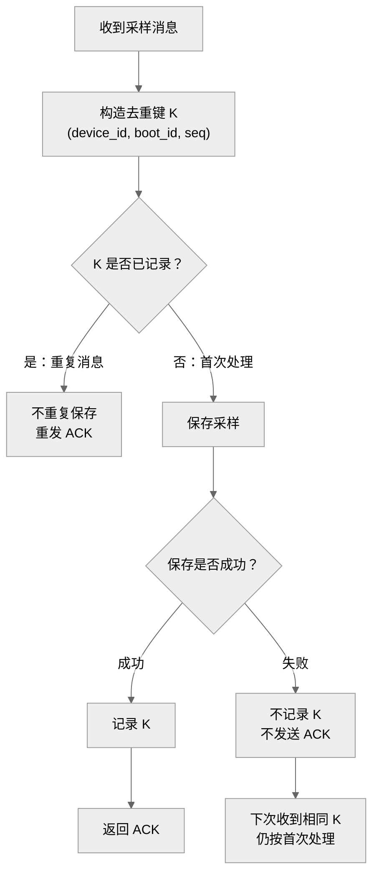

采用**处理流程图 + 逐条判定表**；建议画布约 **900 × 650 px**，使用中性色与系统字体。

去重键是 **`(device_id, boot_id, seq)` 三者组合**。只有保存成功，才记录该键并发送 ACK。

**seq 允许乱序，也不要求连续。** 重启后 `boot_id` 改变，即使再次出现 `seq=1`，也属于新的去重键。

| 收到顺序 | 去重键 | 判定 | 本次成功保存 | 本次发送 ACK |
|---|---|---|---:|---:|
| 1 | `(D1, b7, 2)` | 首次，保存成功 | 1 | 1 |
| 2 | `(D1, b7, 1)` | 首次；乱序不影响处理 | 1 | 1 |
| 3 | `(D1, b7, 2)` | 重复，只重发 ACK | 0 | 1 |
| 4 | `(D1, b8, 1)` | 新启动周期，属于新键 | 1 | 1 |
| **合计** | **3 个不同的键** | | **3 次** | **4 次** |

若某次保存失败，该次保存成功数和 ACK 数均为 **0**，且不留下去重记录。