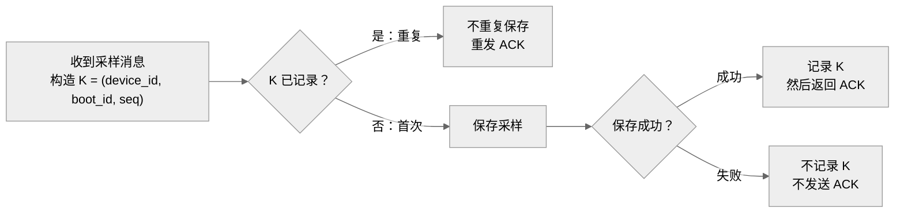

采用**横向处理流程图 + 逐条判定表**，建议画布约 **1200 × 500 px**，减少纵向滚动；使用中性色与系统字体。

去重键为 **`K = (device_id, boot_id, seq)`**。首次处理时，必须**先保存成功，再记录 K 并返回 ACK**。

保存失败后，相同 K 再次到达时仍走“首次”分支。**seq 可以乱序、可以不连续；更换 boot_id 后，相同 seq 属于新键。**

| 收到顺序 | 去重键 K | 处理原因 | 本次成功保存 | 本次 ACK |
|---|---|---|---:|---:|
| 1 | `(D1, b7, 2)` | 新键，保存成功后 ACK | 1 | 1 |
| 2 | `(D1, b7, 1)` | 新键，乱序不影响接收 | 1 | 1 |
| 3 | `(D1, b7, 2)` | 已记录，只重发 ACK | 0 | 1 |
| 4 | `(D1, b8, 1)` | boot_id 改变，是新键 | 1 | 1 |
| **合计** | **3 个不同的键** | | **3 次** | **4 次** |

此例共执行 **3 次保存，全部成功；发送 4 次 ACK**。