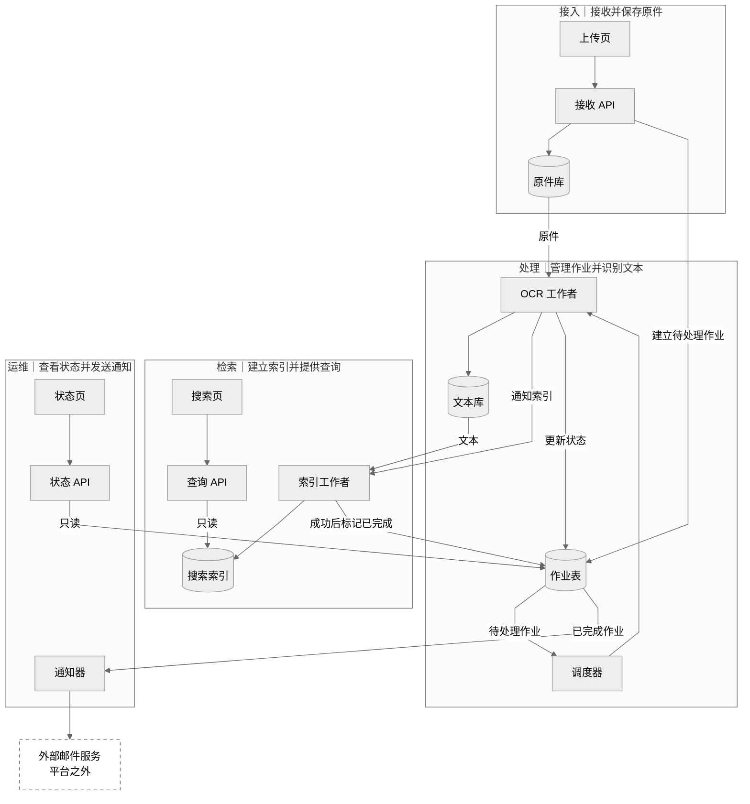
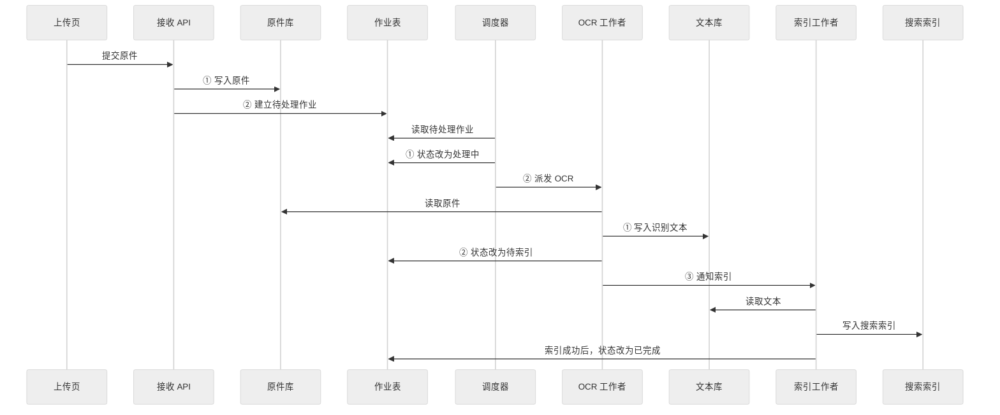
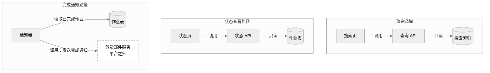
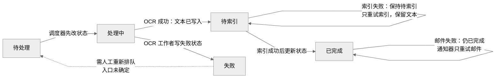

采用 **Markdown + 可编辑 Mermaid**：区域总览、处理时序、查询与通知三组视图，另附失败影响表。建议展示宽度 **1100 px**，高度随内容自适应；使用中性色与系统字体。

## 1. 先看全貌

平台内部共 **14 个单元**，按职责分为四个区域。下图概括成功主链；箭头表示业务推进，具体读写和先后顺序见后续时序图。区域不代表部署边界。

**成功状态链：** 待处理 → 处理中 → 待索引 → 已完成。  
搜索读取搜索索引，状态查询读取作业表；邮件通知以作业已完成为前提。

## 2. 处理明细：读写方向与先后约束

以下按成功路径展开。每条消息按从上到下的顺序发生；“通知”与“派发”不指定协议或传输方式。

## 3. 查询与通知：各自依赖什么

三条路径分别展开，**不表示它们之间存在执行顺序**。查询 API 和状态 API 均只读；通知器读取已完成作业后调用平台外的邮件服务。

图中两处“作业表”是同一个内部单元的重复展示。

## 4. 值班定位：三类失败的影响边界

下表针对**发生失败的这份作业**。“未保证”表示给定事实不足以断言其具体数据状态。

| 失败点 | 作业状态与写入责任 | 本作业受影响的部分 | 保留或不重跑的部分 | 再次处理规则与未知项 |
|---|---|---|---|---|
| **OCR 失败** | OCR 工作者将作业表改为 **失败** | 未进入后续索引成功与完成通知路径；不能保证本作业可搜索 | 原件此前已保存；失败时是否已有文本未说明 | 需要**人工重新排队**；人工操作入口未确定 |
| **索引失败** | 作业保持 **待索引** | 本作业尚未完成；搜索索引更新未成功，不能保证可搜索；通知器不会按已完成作业处理它 | **已写入文本保留，不重跑 OCR** | **只重试索引**；由谁、何时调度未确定 |
| **邮件发送失败** | 作业仍为 **已完成** | 完成邮件发送失败 | OCR 与索引已成功；**不重跑 OCR 或索引**，搜索路径不因该邮件失败而回退 | **通知器只重试邮件发送**；重试时机未确定 |

状态页通过只读作业表，可分别看到 **失败、待索引、已完成**。因此，**“已完成”不能用来判断邮件是否发送成功**；材料没有提供邮件结果的查询入口。

虚线仅表示已知的人工重新排队要求，不表示已存在操作入口。以上视图未添加协议、消息队列、重试调度方式或额外故障处理入口。