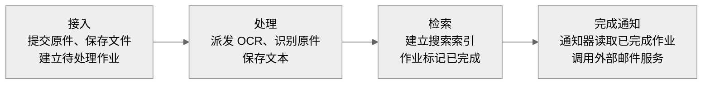
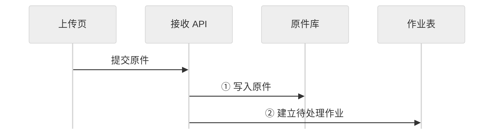
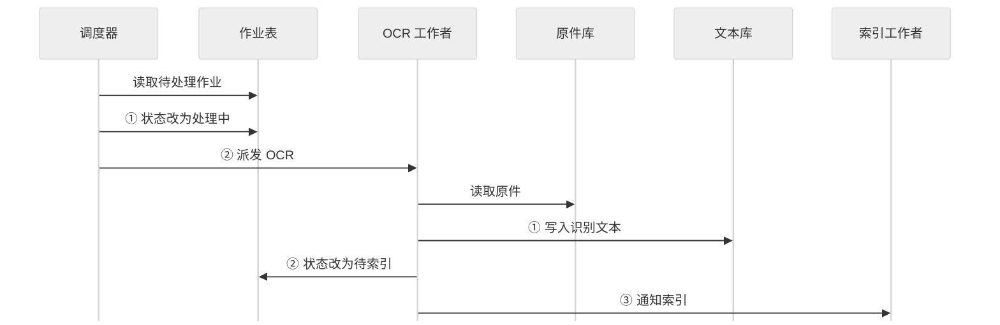
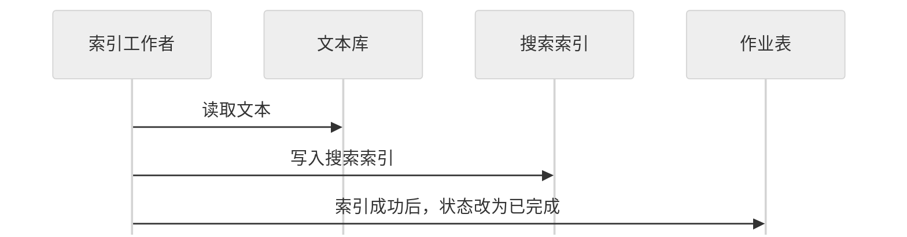
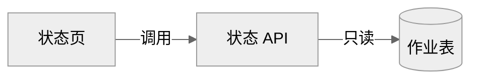
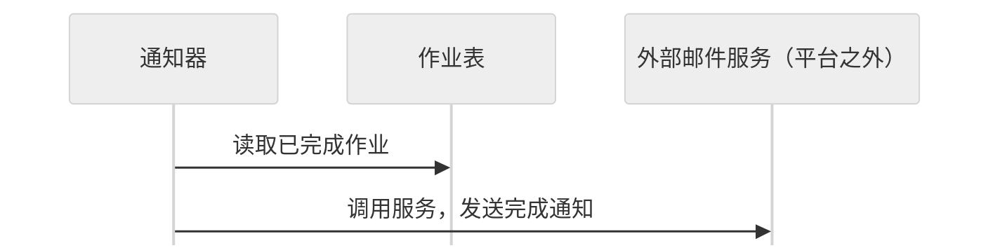
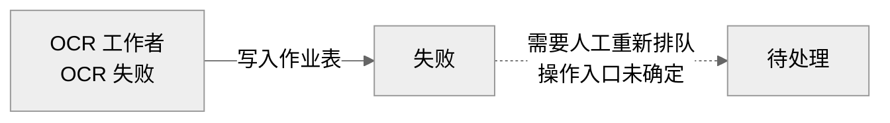
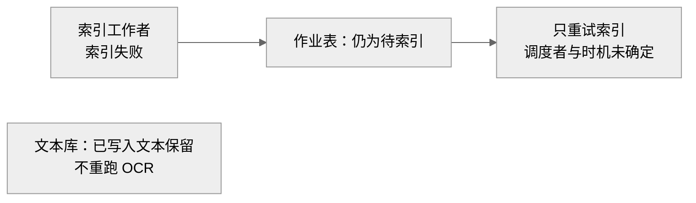
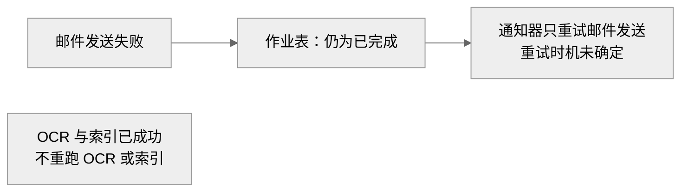

采用 **Markdown + 可编辑 Mermaid**。总览只保留业务阶段，处理时序拆成三段，避免长连线和横向拥挤。建议展示宽度 **1000 px**，各图高度自适应；使用中性色和系统字体。

## 1. 全貌：原件如何变成可搜索内容

这是业务推进关系，不表示部署方式。搜索页通过查询 API 读取搜索索引；状态页通过状态 API 读取作业表，两者的读取路径见第 3 节。

内部 **14 个单元**分别承担以下职责，明细图中逐一保留：

| 区域 | 单元与职责 |
|---|---|
| 接入 · 3 个 | **上传页**：提交原件；**接收 API**：保存原件并建立作业；**原件库**：保存原始文件 |
| 处理 · 4 个 | **作业表**：保存作业状态；**调度器**：查找待处理作业并派发 OCR；**OCR 工作者**：识别原件并保存文本；**文本库**：保存识别结果 |
| 检索 · 4 个 | **索引工作者**：读取文本并更新索引；**搜索索引**：保存可查询索引；**查询 API**：读取搜索索引；**搜索页**：供用户检索 |
| 运维 · 3 个 | **状态页**：查看作业状态；**状态 API**：只读作业表；**通知器**：查找已完成作业并调用外部邮件服务 |

外部邮件服务不属于平台。区域是职责划分，不代表部署边界。

## 2. 成功主链：读写方向与先后顺序

时序图从上到下阅读。跨图同名单元表示同一个单元；拆图不增加任何组件或通信机制。

### ① 接收：先保存原件，再建立作业

### ② OCR：先改为处理中，再派发；先保存文本，再推进状态

### ③ 索引：写入成功后，作业才标记已完成

## 3. 查询与通知：各自依赖哪里

三条路径独立展示，图与图之间没有执行顺序。

**搜索路径：只读搜索索引。**

**状态路径：只读作业表。**

**通知路径：先读取已完成作业，再调用平台外的邮件服务。**

## 4. 失败定位：停在哪里，哪些结果保留

以下影响均针对**发生失败的这份作业**，不将单份作业失败推断为整个平台不可用。

### OCR 失败：作业进入失败状态

- 原件在此前已保存；失败时是否已写入部分文本，材料未说明。
- 本次失败路径未推进到索引成功和完成通知，不能保证本作业可搜索。
- 再次处理需要人工重新排队；虚线表示这一要求，不代表存在已知操作入口。

### 索引失败：保持待索引，保留文本

- 搜索索引更新未成功，不能保证本作业可搜索；失败后的索引具体内容未说明。
- 作业尚未完成，通知器不会按已完成作业处理它。
- 已有文本保留，重试范围限于索引。

### 邮件失败：仍已完成，只重试邮件

- 失败影响完成邮件的发送；搜索索引和作业完成状态不因该失败而回退。
- 状态页仍显示已完成，因此 **“已完成”不能证明邮件已发送成功**。
- 材料没有提供邮件结果的查询入口。

### 值班速查

| 失败点 | 状态页可见状态 | 已知保留的结果 | 再次处理范围 | 尚未确定 |
|---|---|---|---|---|
| OCR | **失败** | 已保存的原件 | 人工重新排队 | 人工操作入口 |
| 索引 | **待索引** | 原件、已写入文本 | 只重试索引，不重跑 OCR | 谁调度、何时调度 |
| 邮件 | **已完成** | 原件、文本、成功的搜索索引 | 通知器只重试邮件 | 邮件重试时机 |

传输协议、消息队列、部署方式均未提供；以上图解不对这些内容作假设。