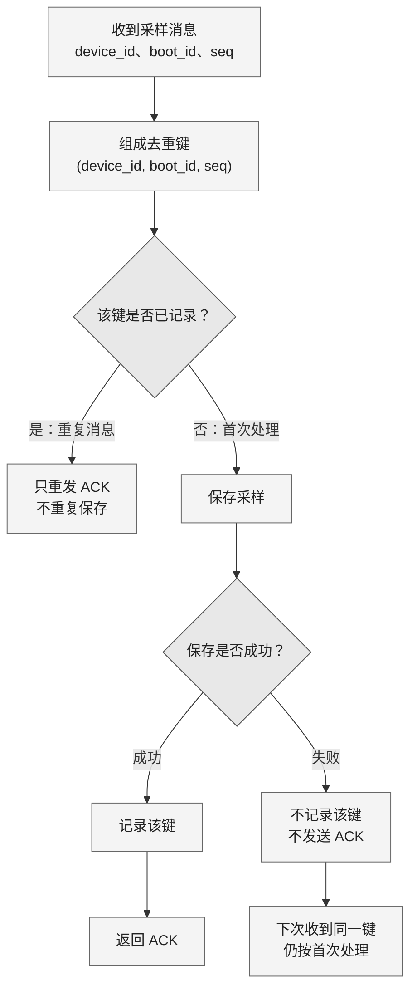

采用**处理流程图 + 示例表**；流程图建议画布约 **800 × 640 px**。去重键必须是完整的 `(device_id, boot_id, seq)`，仅成功保存后才记录该键。

**示例：所有首次保存均成功**

| 接收顺序 | 去重键 | 判断 | 本次保存次数 | 本次 ACK 次数 |
|---|---|---|---:|---:|
| 1 | `(D1, b7, 2)` | 首次收到，保存后 ACK | 1 | 1 |
| 2 | `(D1, b7, 1)` | 不同键；乱序也正常保存 | 1 | 1 |
| 3 | `(D1, b7, 2)` | 重复键，只重发 ACK | 0 | 1 |
| 4 | `(D1, b8, 1)` | 新启动周期，不同键 | 1 | 1 |
| **合计** | **3 个不同键** | | **3** | **4** |

`seq` **允许乱序，也不要求连续**。重启后 `boot_id` 改变，因此 `(D1, b8, 1)` 与 `(D1, b7, 1)` 是两个不同的去重键。

以上为可编辑草稿，尚未进行实际渲染检查。