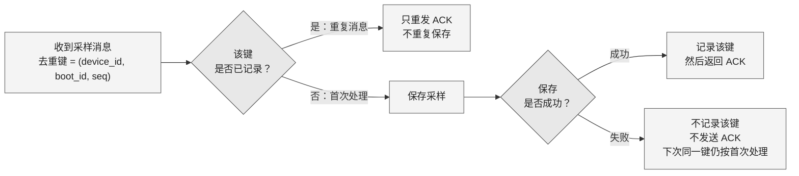

采用**横向处理流程图 + 示例表**，建议画布约 **1200 × 500 px**，减少上一版的纵向高度。已查看实际渲染：文字可读、连线无明显遮挡；本次横向布局待渲染确认。

**去重键是完整的 `(device_id, boot_id, seq)`；保存成功后才记录该键并发送 ACK。**

**示例：按下表顺序接收，所有首次保存均成功。**

| 接收顺序 | 去重键 | 处理结果 | 本次保存次数 | 本次 ACK 次数 |
|---|---|---|---:|---:|
| 1 | `(D1, b7, 2)` | 首次收到，保存后 ACK | 1 | 1 |
| 2 | `(D1, b7, 1)` | 不同键，乱序也正常保存 | 1 | 1 |
| 3 | `(D1, b7, 2)` | 重复键，只重发 ACK | 0 | 1 |
| 4 | `(D1, b8, 1)` | `boot_id` 已变化，是新键 | 1 | 1 |
| **合计** | **3 个不同键** | | **3** | **4** |

`seq` **允许乱序，不要求连续**。每次重启生成不同的 `boot_id`，因此新启动周期可以再次出现 `seq=1`：`(D1, b8, 1)` 与 `(D1, b7, 1)` 不重复。