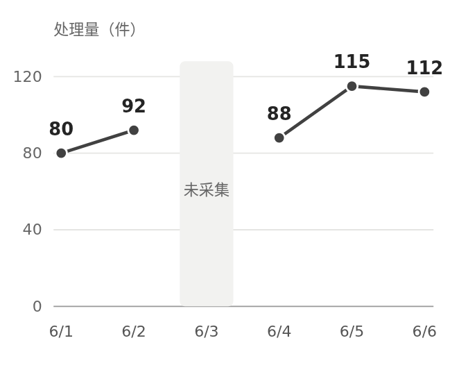
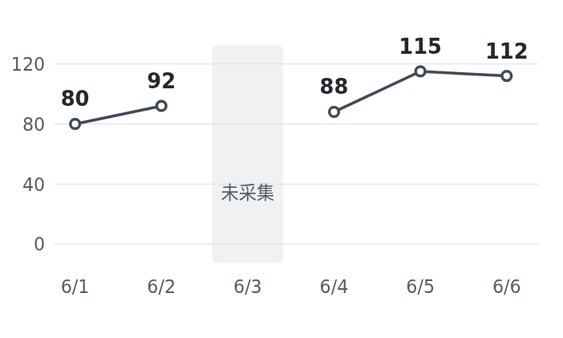
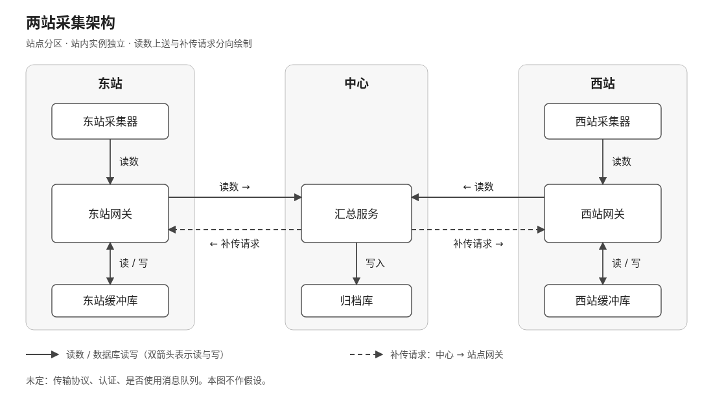
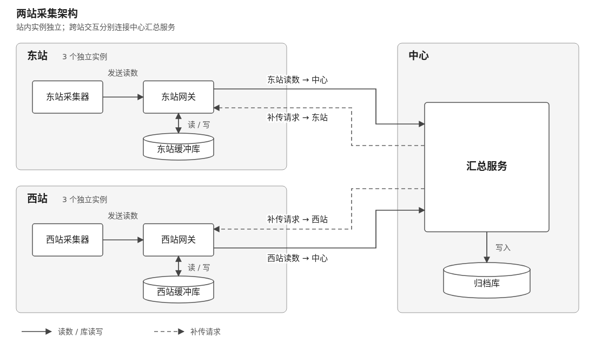
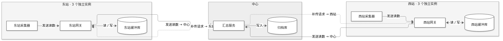
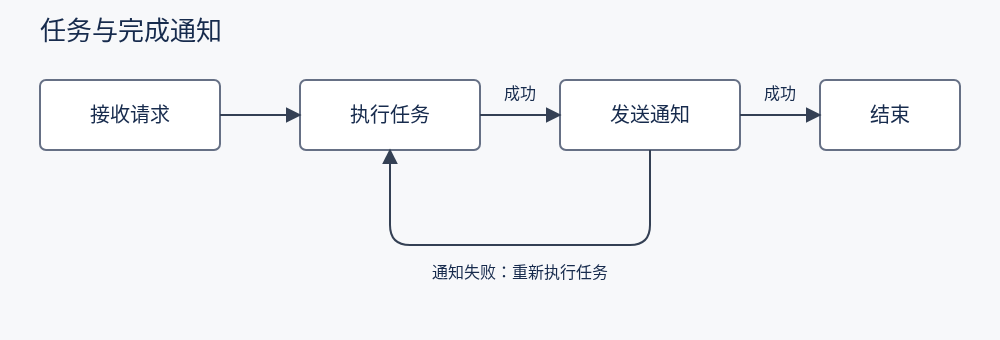
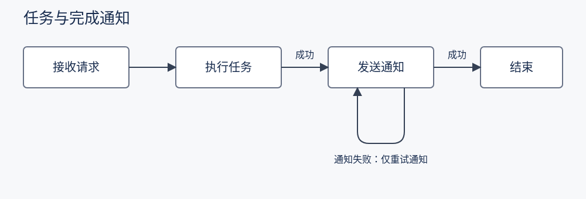

# visual-explanation_2与 0.4.2：增补三例

**增加三例后，没有发现新版相对0.4.2的稳定整体优势。** 本轮缺失数据趋势、多实例反向交互、局部SVG修改三题，双方均准确完成核心要求；差别主要是页面组织和布局。

趋势图：五个观测值、日期、刻度和缺失日断线均正确，手机可直接读完。多实例：两版都保留8个独立主体和双向交互，桌面连线清楚。SVG局部修改：最终源完全相同，均只改失败回路和标签，其他内容保持。

新版实例图最后改了ID、无障碍说明和格式，源码有变，但最终主图与它已看到的图片像素完全相同；不能把这种源变动等同未检查的新布局。其余五条轨迹的最后源均保持已反馈版本。

连同[上一轮两题](../2026-10-14-v2-v042/comparison.md)，目前覆盖五种任务：去重、缺失趋势、多实例、局部改图基本相当；复杂平台总览中新版更便于沿图追关系，0.4.2的单页速查更集中。**可以继续使用新版，不需要据此再加规则；仍不足以宣布全面替代优势。** 这是跨两轮逐题观察，不是同题多次抽样或稳定胜率。

两版均使用同一实际模型、同等两轮桌面图片反馈；可选扩展未安装，不验证am或其他后端接入。原始输出、图片与源码全部保留，未修改任何Skill。

每版三题、六条独立容器/会话轨迹，每条两次真实桌面图片反馈。相同模型；趋势题要求HTML、实例题可选图种、局部修改题要求原生SVG。可选扩展均不可用，测试回退路径。详见 [协议与限制](README.md)。

## 产出规模

| 题目 | Skill | 最终图数 | 原生格式 | 图源码字符 | 全部代码块字符 | 三次调用输出 tokens | 最后反馈后仍改图 |
|---|---|---:|---|---:|---:|---:|---|
| 01-missing | visual-explanation 0.4.2 | 1 | HTML/SVG | 3,560 | 3,560 | 9,610 | 否，模型已收到相同图源码的画面 |
| 01-missing | visual-explanation_2 | 1 | HTML/SVG | 3,361 | 3,361 | 9,146 | 否，模型已收到相同图源码的画面 |
| 02-instances | visual-explanation 0.4.2 | 1 | HTML/SVG | 5,107 | 5,107 | 12,296 | 否，模型已收到相同图源码的画面 |
| 02-instances | visual-explanation_2 | 1 | HTML/SVG | 5,010 | 5,010 | 8,461 | 源变；主图像素相同 |
| 03-svg-edit | visual-explanation 0.4.2 | 1 | SVG | 1,902 | 1,902 | 4,584 | 否，模型已收到相同图源码的画面 |
| 03-svg-edit | visual-explanation_2 | 1 | SVG | 1,902 | 1,902 | 4,749 | 否，模型已收到相同图源码的画面 |

图数按实际主 SVG/Mermaid 图计数，一份 HTML 可能含多图；伪代码不计作图片，但计入全部代码块。HTML 包含页面样式、文字与表格，Mermaid 源不含外围 Markdown，因此源码字符只反映各自交付物规模。token 是本轮 CLI 用量，含修订，不代表价格或正常按需读取的最低消耗。未测真实需求变更工时。

## 缺失数据趋势

两版均符合核心目标，数据、断线与日期正确，手机也能直接读完。没有明确的质量胜负。

### visual-explanation 0.4.2

[最终原始回答](outputs/v042/01-missing.md) · [初稿](trajectories/v042/01-missing/stage0/answer.md) · [第一次修订](trajectories/v042/01-missing/stage1/answer.md) · [最终阶段](trajectories/v042/01-missing/stage2/answer.md)

**内容：** 6月1日至6日完整日期、五个观测值80/92/88/115/112和单位件保留；6月3日明确未采集，两段折线不连接缺失日。没有补值、零点或预测。

**忠实性：** 线性映射y=240−1.5×值：五点120/102/108/67.5/72，刻度0/40/80/120位置一致。日期等距，缺失日保留横轴位置。

**实际画面：** 一张360×290自适应SVG，缺失日用浅灰带与未采集说明。桌面、390px手机均清楚，页面无横向溢出或局部滚动；说明较突出。

**检查闭环：** 最终源保持stage1已反馈版本。模型只声明看过桌面，明确手机未验证；评审另看移动截图。

[可编辑 HTML](trajectories/v042/01-missing/render-inputs/stage1-1.html) · [完整桌面页](trajectories/v042/01-missing/rendered/stage1-1-desktop.png) · [移动截图](trajectories/v042/01-missing/rendered/stage1-1-mobile.png)

GitHub 不直接执行 HTML；下载 HTML 后用浏览器打开即可查看原生页面。

查看初稿实际画面

### visual-explanation_2

[最终原始回答](outputs/candidate/01-missing.md) · [初稿](trajectories/candidate/01-missing/stage0/answer.md) · [第一次修订](trajectories/candidate/01-missing/stage1/answer.md) · [最终阶段](trajectories/candidate/01-missing/stage2/answer.md)

**内容：** 同样完整日期、五个原值、单位和缺失信息；6月3日无点，折线断开，不补值、不记零。

**忠实性：** y=260−1.6×值，五点132/112.8/119.2/76/80.8，与0/40/80/120刻度一致。缺失日占据自己的日期位置。

**实际画面：** 一张600×360自适应SVG，浅灰缺失带、空心数据点；桌面与手机文字可读，无横向滚动。页面更紧凑，和对照没有实质理解差别。

**检查闭环：** 最终源保持已回传stage1版本，明确未看手机。评审已核对移动截图。

[可编辑 HTML](trajectories/candidate/01-missing/render-inputs/stage1-1.html) · [完整桌面页](trajectories/candidate/01-missing/rendered/stage1-1-desktop.png) · [移动截图](trajectories/candidate/01-missing/rendered/stage1-1-mobile.png)

GitHub 不直接执行 HTML；下载 HTML 后用浏览器打开即可查看原生页面。

查看初稿实际画面

## 独立实例与反向控制关系

两版均符合核心目标，实例、归属和反向交互都可直接辨认。左右对称与上下站点只是布局取舍，未发现明确质量胜负。

### visual-explanation 0.4.2

[最终原始回答](outputs/v042/02-instances.md) · [初稿](trajectories/v042/02-instances/stage0/answer.md) · [第一次修订](trajectories/v042/02-instances/stage1/answer.md) · [最终阶段](trajectories/v042/02-instances/stage2/answer.md)

**内容：** 相同8个主体及9项关系完整，站点实例未合并，两种相反方向分别有标签和箭头。

**忠实性：** 双箭头库关系明确标注读/写，补传虚线方向中心→站点。协议、认证、队列均保持未定。

**实际画面：** 1100×620的HTML/SVG，东站/中心/西站左右对称，读数与补传平行分离；区域和线路清楚。手机也随整图缩小，本题未要求手机，不用此项判劣。

**检查闭环：** 最终HTML与已反馈stage1完全相同。实际图面已查看，自检返回通过；几何脚本仅作辅助，不代替语义核对。

[可编辑 HTML](trajectories/v042/02-instances/render-inputs/stage1-1.html) · [完整桌面页](trajectories/v042/02-instances/rendered/stage1-1-desktop.png) · [移动截图](trajectories/v042/02-instances/rendered/stage1-1-mobile.png)

GitHub 不直接执行 HTML；下载 HTML 后用浏览器打开即可查看原生页面。

查看初稿实际画面

### visual-explanation_2

[最终原始回答](outputs/candidate/02-instances.md) · [初稿](trajectories/candidate/02-instances/stage0/answer.md) · [第一次修订](trajectories/candidate/02-instances/stage1/answer.md) · [最终阶段](trajectories/candidate/02-instances/stage2/answer.md)

**内容：** 东站与西站各3独立单元，中心汇总服务与归档库，共8个主体；两站本地读写、上行读数、中心写归档及反向补传共9项关系（库读写合并表示）均保留。

**忠实性：** 实线表示读数/库访问，虚线为中心→站点的补传，方向清楚；不补设协议、鉴权或队列。

**实际画面：** 初稿Mermaid在图片反馈后换为1100×640的HTML/SVG，东、西站上下排在左，中心在右，两种跨站流用分离线路。桌面清楚可追踪。手机整图缩小、字号很小；本题没有要求手机适配，不因此扣减原题质量。

**检查闭环：** 最后改变ID/无障碍说明并格式化源码，模型如实标为未再看。评审再渲染后主SVG截图与已反馈stage1逐字节相同；不把它当新的可见布局问题。

[可编辑 HTML](trajectories/candidate/02-instances/render-inputs/stage2-1.html) · [完整桌面页](trajectories/candidate/02-instances/rendered/stage2-1-desktop.png) · [移动截图](trajectories/candidate/02-instances/rendered/stage2-1-mobile.png)

GitHub 不直接执行 HTML；下载 HTML 后用浏览器打开即可查看原生页面。

查看初稿实际画面

## 只修改通知失败环路

[修改前的原始SVG](inputs/fixtures/notification-flow.svg)

[变更范围核对](svg-edit-review.json)：比较正常路径、文字、样式与失败环路。

两版都准确完成局部修改，最终SVG完全相同。该例验证了变更范围保留，没有提供优劣证据。

### visual-explanation 0.4.2

[最终原始回答](outputs/v042/03-svg-edit.md) · [初稿](trajectories/v042/03-svg-edit/stage0/answer.md) · [第一次修订](trajectories/v042/03-svg-edit/stage1/answer.md) · [最终阶段](trajectories/v042/03-svg-edit/stage2/answer.md)

**内容：** 同样正确修改为仅重试通知，成功主链不变。

**忠实性：** 同样仅修改两个允许元素，原图其他部分完整保留；详见svg-edit-review.json的原图diff和XML范围核对。

**实际画面：** 两版最终SVG完全相同，画面没有质量差别。

**检查闭环：** XML解析和真实渲染均通过，最终源与已反馈stage1相同。

[可编辑原生 SVG](trajectories/v042/03-svg-edit/render-inputs/stage1-1.svg)

查看初稿实际画面

### visual-explanation_2

[最终原始回答](outputs/candidate/03-svg-edit.md) · [初稿](trajectories/candidate/03-svg-edit/stage0/answer.md) · [第一次修订](trajectories/candidate/03-svg-edit/stage1/answer.md) · [最终阶段](trajectories/candidate/03-svg-edit/stage2/answer.md)

**内容：** 通知失败回路返回发送通知，不再返回执行任务；失败标签同步改为仅重试通知。

**忠实性：** 与原SVG比较，只修改failure的路径和failure-label的文字/位置；正常路径、其他文字、样式、尺寸和节点均保持原样。

**实际画面：** 1000×340原生SVG，失败环路位于通知节点下方，箭头回到该节点底边，标签无明显遮挡。

**检查闭环：** XML解析通过，最终源保持已反馈stage1版本。与0.4.2最终SVG逐字节相同；独立会话/记录保留，不是复用另组结果。

[可编辑原生 SVG](trajectories/candidate/03-svg-edit/render-inputs/stage1-1.svg)

查看初稿实际画面

## 证据与限制

六条轨迹独立容器、独立会话、无其他组输出挂载；各阶段实际模型与源码哈希见 [runs.json](runs.json)。生成不调用工具，渲染由控制器完成，不测客户端自动加载。每题每组一个样本，主 Agent 知道组别后评审；不能据此宣布普遍排名。

[内容评审](content-review.json) · [用量与修订规模](metrics.json) · [Mermaid（本轮无最终源）](syntax-results.json) · [输入及输出完整性](integrity-results.json)

本轮没有测试 am、diagram-design 或 mermaid-diagrams 的原生接入；不用未加载的工具为输出背书。渲染成功不是语义或理解效果证明；具体问题以原始材料、源码与实际画面为依据。
