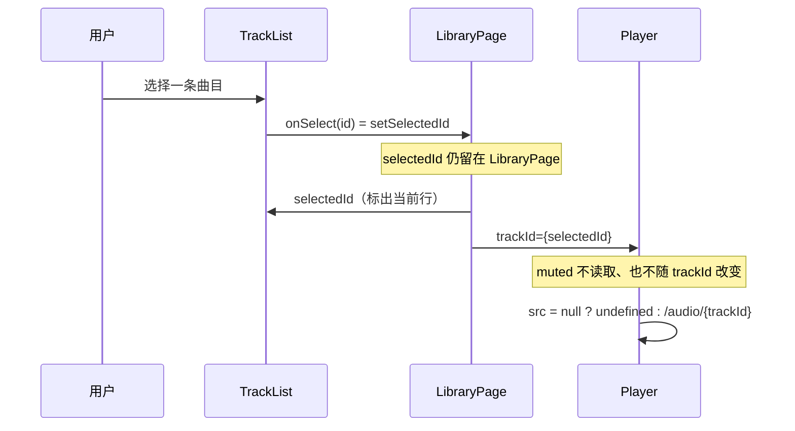

我先读取本题指定的 skill，再只根据 `LibraryPage.tsx` 说明选中曲目、静音和列表选择如何影响播放器。

选中曲目在 `LibraryPage`，静音在 `Player`。列表不直接操作播放器，只通过父组件的 `selectedId` 把曲目 id 传下去。

```tsx
<LibraryPage> (src/LibraryPage.tsx)
  useTracks() → tracks
  useState selectedId: string | null = null   // 选中曲目：父组件持有
  <TrackList> (packages/ui/TrackList)
    tracks
    selectedId
    onSelect={setSelectedId}
  <Player> (同文件，未导出)
    trackId={selectedId}                       // 只接收，不持有
    useState muted = false                     // 静音：Player 自己持有
    <audio src muted controls>
    <button> setMuted(v => !v)
```

| 状态 | 持有者 | 初值 | 谁改它 | 播放器怎么用 |
|---|---|---|---|---|
| `selectedId` | `LibraryPage` | `null` | `TrackList` 调用 `onSelect`，即 `setSelectedId` | 作为 `trackId` 传入 |
| `muted` | `Player` | `false` | 只有播放器里的按钮 | 直接作为 `<audio muted>` |



换曲只改 `trackId`，从而改 `<audio>` 的 `src`：未选时 `src` 为 `undefined`，选中后是 `/audio/${trackId}`。`Player` 始终挂在树上，也没有 `key={trackId}`，所以换曲不会重新执行 `useState(false)`。静音留在 `Player` 内部，列表既读不到它，也不会在换曲时把它复位。
